# Next-Best-Action Recommender for Reps: Hybrid Collaborative + Contextual Design

> **Audience:** NBA algo / data-science team · **Market:** Italy first (design is market-agnostic) ·
> **Status:** design proposal v0.1 (2026-10-23) · **Scope:** design, brainstorm and education. No production code yet.
>
> **Rendering:** Mermaid diagrams render on GitHub and in the VS Code Markdown preview (install the *Markdown Preview
> Mermaid Support* extension if the diagrams show as code). Math uses `$…$` and renders in the VS Code preview and on GitHub.
>
> **Evidence:** every number in this document comes from read-only aggregate queries listed in
> [Appendix A](#appendix-a-evidence-sql) (tags like **[E9]** point to the query). Data as of 2026-10-23.

## Table of contents

0. [Executive summary](#0-executive-summary)
1. [Current state of the rule engine](#1-current-state-of-the-rule-engine)
2. [Data landscape and evidence](#2-data-landscape-and-evidence)
3. [Primer on the core concepts](#3-primer-on-the-core-concepts)
4. [Target architecture](#4-target-architecture)
5. [Themes as configuration](#5-themes-as-configuration)
6. [Algorithms](#6-algorithms)
7. [LLM-generated suggestion text](#7-llm-generated-suggestion-text)
8. [Evaluation](#8-evaluation)
9. [MLOps and the feedback loop](#9-mlops-and-the-feedback-loop)
10. [Roadmap, risks and open questions](#10-roadmap-risks-and-open-questions)

- [Appendix A. Evidence SQL](#appendix-a-evidence-sql)
- [Appendix B. Glossary](#appendix-b-glossary)

---

## 0. Executive summary

**The problem.** Today every next-best-action (NBA) is a hand-built rule. Each rule is a notebook generated from UI filters:
85 leaf notebooks (72 distinct rule names) plus an orchestrator in `RE/comm`. Each rule combines four kinds of hand-set
logic:

- **Trigger recency:** `DAYS_SINCE_LAST_CALL_BY_PRODUCT <= 7`.
- **Cooldowns:** `DAYS_SINCE_LAST_EMAIL_SENT >= 28`.
- **Feedback suppressions:** `DAYS_SINCE_SURVEY_OPTION_1E >= 90`.
- **A static score:** effectively the RACE-segment weight.

The thresholds are guesses. They are the same for every rep and HCP, they are never learned from outcomes, and every new
theme × product × specialty combination needs new SQL.

**The proposal.** Separate *what* we want to recommend from *when and to whom*:

1. **Themes become configuration.** A theme (e.g. "after a call, send a 1:1 email") is a declarative spec. It names the
   trigger event, the target action, the outcome, the hard constraints, the text template and the lifespan. Adding a theme
   means adding a config, not writing threshold SQL.
2. **A learned, hybrid scorer decides when and for whom.**
   - *Contextual* part: gradient-boosted trees learn the "DAYS_SINCE" cut-offs and their interactions from data.
   - *Collaborative* part: implicit-feedback matrix factorisation embeds reps (how they follow up) and HCPs (how they
     engage by channel and content). Sparse rep–HCP pairs then borrow strength from similar reps and HCPs.
3. **Objective (hybrid):** expected value
   $EV = P(\text{rep acts}) \times P(\text{HCP engages} \mid \text{action}) \times v(\text{HCP}, \text{product})$.
   Acting alone favours obvious suggestions. Engagement alone favours suggestions nobody acts on.
4. **Policy.**
   - Rank candidates by EV within each rep's capacity.
   - Deduplicate and route between reps who share an HCP.
   - Keep a small amount of exploration and log its propensities, so the policy can later be evaluated off-policy.
5. **Hard rules stay hard.** Consent, do-not-contact, bounces, the HCP's "no emails" preference (dismissal reason 1e),
   rep time-off, hold-out and rep opt-outs are never learned away.
6. **Text.** An LLM writes the Italian title and reason from a *facts-only* payload (no PII). Guardrails cover grounding,
   claims and length, with an approved-template fallback.
7. **Delivery is unchanged.** It is a daily batch into the existing `it_comm_algo_*_output` contract (`TAGS` / `COMMENTARY`
   → Veeva Suggestions). Subscriptions are **opt-out**: everything is on by default, a rep can unsubscribe per theme or per
   HCP, and an unsubscription is both a hard filter and a learning signal.

**MVP theme: `POST_CALL_EMAIL` (rep → digital).** After a call, the rep is nudged to send a 1:1 approved email. This one
theme would replace 26 of the 27 email-type rule notebooks (6 "Email Reminder" plus 20 "eDetail follow-up").

**What the data says (Italy):**

| Evidence | Number | So what |
|---|---|---|
| F2F calls followed by a same-rep 1:1 email within 7 days **[E9]** | **7.7 %** of 412,710 calls; 2.5 % on the same day | A next-morning batch can only influence the day 1–7 window, which holds about 5.2 % of calls **[E10]** |
| Per-rep 7-day follow-up rate **[E11]** | p10 0.5 % · median 5.3 % · p90 15.6 % | Strong rep effect, i.e. a *collaborative* signal |
| Current email suggestions **[E6]** | 26,672 per year · 48 % actioned · 15 % dismissed | Good baseline and good labels |
| Top dismissal reasons for email suggestions **[E7]** | 25 % "already sent", 18 % "no suitable approved email" | Fixable with a "not already actioned" constraint and later content personalisation |
| 1:1 email engagement **[E12]** | 44 % unique open, 6 % "opened" within 60 s, 5.0 % click | Opens are a weak label, so use clicks and opens after 60 s |
| Post-call emails vs other emails **[E12]** | click 3.9 % vs 6.4 % | Confounded, so incrementality must be measured, not assumed |
| 1:M email engagement → rep call within 7 days **[E13]** | 8.2 % after an open vs 7.5 % after mere delivery | Digital signals are not acted on today. This is the Phase-3 opportunity |
| Suggestion load **[E8]** | median 5 per rep-week (p90 12) | Capacity is the binding constraint, so ranking is the core ML problem |

**Evaluation path:**

1. Time-based backtests against a replay of the current rule.
2. Shadow mode.
3. A/B test randomised by rep cluster, plus the HCP hold-out for incrementality.
4. Off-policy evaluation once exploration logs exist.

**What changes for the team:** instead of writing and tuning SQL thresholds per product, the team defines themes, curates
features and constraints, and reviews evaluation reports.

---

## 1. Current state of the rule engine

### 1.1 Anatomy of a rule notebook

Every leaf notebook in `RE/comm` follows the same generated template. Example: *IT Anoro Email Reminder Fastrack1*
(`it_comm_algo_1c98c52d_…`), a post-call email rule:

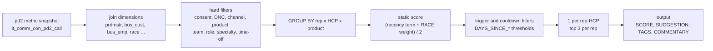

Condensed SQL of that rule (real filters, simplified joins):

```sql
WITH cte AS (
  SELECT dim.BUS_EMPLOYEE_CODE, dim.BUS_CUSTOMER_CODE, dim.BUS_PRODUCT_CODE, ...,
         DATEDIFF(DAY, MAX(TO_DATE(last_activity_date_text,'yyyyMMdd')), CURRENT_DATE) AS DAYS_SINCE_LAST_CALL_BY_PRODUCT,
         MIN(met.DAYS_SINCE_SURVEY_OPTION_1E) AS DAYS_SINCE_SURVEY_OPTION_1E, ...,          -- rep dismissal reasons
         ( LEAST(GREATEST(MIN(met.DAYS_SINCE_LAST_CALL),0),365)/365                       -- recency term
           + (CASE race WHEN 'Conversion' THEN 1 WHEN 'Acquisition' THEN 0.8
                        WHEN 'Engagement' THEN 0.8 END - 0.8)/0.2 ) / 2 AS ALGORITHM_NBA_SCORE
  FROM it_comm_con_pd2_call met JOIN it_comm_con_prdmstr_call dim ON met.DIM_ID = dim.DIM_ID  -- + 10 dim joins
  WHERE BUS_HAS_CONSENT_APPROVED_EMAIL_CODE = 'Y' AND BUS_GSK_DO_NOT_CONTACT_CODE IN ('Unknown','N')
    AND BUS_INTERACTION_CHANNEL_CODE IN ('F2F','Virtual','Web call','Phone call', ...)
    AND BUS_PRODUCT_CODE = '<Anoro>' AND BUS_TEAM_CODE = '<team>' AND BUS_EMPLOYEE_ROLE_CODE = 'Rep'
    AND BUS_CUSTOMER_PRI_SPECIALTY_CODE = 'Pneumology'                                    -- sub-rule 2: GPs
    AND BUS_RACE_CODE IN ('Conversion','Engagement','Acquisition')
    AND BUS_TOT_HOURS_NEXT_7_DAYS_CODE < 24                                               -- rep time-off
    AND customer NOT IN (<HCPs who received this template in the last 180 days>)
  GROUP BY ...
)
SELECT *, <Italian commentary>, <TAGS json> FROM cte
WHERE DAYS_SINCE_LAST_CALL_BY_PRODUCT <= 7                       -- trigger
  AND DAYS_SINCE_LAST_EMAIL_SENT >= 28                           -- fatigue cooldown
  AND DAYS_SINCE_SENT_EDETAIL_SUGGESTION >= 28                   -- suggestion cooldown
  AND DAYS_SINCE_SURVEY_OPTION_1E >= 90                          -- "HCP does not want emails"
  AND DAYS_SINCE_SURVEY_OPTION_2E >= 30 AND ..._3E >= 30 AND ..._4E >= 30
  AND DAYS_SINCE_SFMC_HARD_BOUNCE = 999                          -- never bounced
QUALIFY ROW_NUMBER() OVER (PARTITION BY rep, hcp ORDER BY score DESC) = 1   -- then top 3 per rep
```

> **Teaching moment: hand-made scores drift from intent.** The trigger already requires a product call within the last 7
> days, so the recency term is close to zero for nearly every qualifying row. In practice the ranking is driven mostly by
> the RACE weight: Conversion scores about 0.5 and everything else about 0. It also *mixes* "how valuable is this HCP" with
> "how likely is the action", which the proposed design separates on purpose (§6.1).

### 1.2 Rule taxonomy

The 85 leaf notebooks group into 13 families, classified by rule name and source metric table:

| Family | Notebooks | Distinct names | Source metric table | Typical output | Proposed theme |
|---|---:|---:|---|---|---|
| eDetail / CLM follow-up | 25 | 19 | `pd2_clckstrm` | Email (20), Call (5), Insight (1) | **POST_CALL_EMAIL** (MVP) |
| Post-call email reminder | 6 | 6 | `pd2_call` | Email | **POST_CALL_EMAIL** (MVP) |
| Event / webinar follow-up | 9 | 8 | `pd2_webinar` (8), `pd2_call` (1) | Insight (9), Call (1) | EVENT_FOLLOWUP |
| Email-open notification | 3 | 3 | `pd2_webinar` | Insight / Email | EMAIL_ENGAGEMENT_TO_REP |
| Website engagement | 5 | 2 | `pd2_website` | Insight | DIGITAL_ENGAGEMENT_TO_REP |
| Under-call (call-plan pacing) | 7 | 6 | `pd2_call` | Call | REENGAGE |
| Over-call / compliance / sales anomaly | 6 | 5 | `pd2_call` | Insight | keep as rules (compliance) |
| Consent capture | 5 | 5 | `pd2_call` | Insight | CONSENT_CAPTURE (later) |
| Key-message reminder | 5 | 5 | `pd2_clckstrm` | Insight | Phase-4 content theme |
| Team coordination | 7 | 6 | `pd2_call` | Insight | keep as rules (informational) |
| Veeva Link (KOL insight) | 3 | 3 | `pd2_veevalink` | Insight | keep as rules (informational) |
| RACE evolution | 2 | 2 | `pd2_call` | Insight | keep as rules (informational) |
| Manual push / test | 2 | 2 | mixed | – | – |

Not everything should become ML. *Informational* insights (a colleague visited the HCP, Veeva Link data) and *compliance*
rules (over-call limits) are deterministic by nature and should stay rules. The learned policy targets **action**
suggestions, where a rep chooses whether to act and the HCP chooses whether to respond.

### 1.3 The output contract to preserve

Orchestrator notebooks `UNION` child outputs and keep the top 2 per (rep, HCP). The columns the downstream Veeva push
expects are:

| Column | Meaning | Notes for the new engine |
|---|---|---|
| `ALGORITHM_NBA_RANK` | rank within rep (and rep-HCP) | from the policy (§6.5) |
| `ALGORITHM_NBA_SCORE` | numeric score | EV, scaled to [0, 1] |
| `DIM_ID` | key into the `it_comm_con_prdmstr_*` dimension | look up from the dimension tables (open question O6) |
| `BUS_EMPLOYEE_CODE`, `BUS_CUSTOMER_CODE`, `BUS_COUNTRY_CODE`, `BUS_PRODUCT_CODE`, `BUS_TERRITORY_CODE`, `BUS_TEAM_CODE` | business keys | Veeva IDs (`005…` user, `001…` account, `a00…` product) |
| `ALGORITHM_NBA_SUGGESTION` | sub-algorithm code, e.g. `EMR_E_IT_ANO_COM_1` | `<THEME>_<MODEL_VERSION>` for traceability |
| `TAGS` | JSON with `SUGGESTION_SURVEY_VOD__C`, `SUGGESTION_LIFESPAN`, `TITLE_VOD__C`, `RECORD_TYPE_NAME_VOD__C`, `PRIORITY_VOD__C`, optional `EMAIL_TEMPLATE_ID_VOD__C` / `EMAIL_TEMPLATE_VAULT_ID_VOD__C` | title comes from the LLM (§7). Priority uses Italy's values `Normal_vod` / `Urgent_vod` |
| `COMMENTARY` | reason text (HTML-ish `<li>`) | from the LLM (§7) with template fallback |

Existing rules already put a hand-mapped `EMAIL_TEMPLATE_ID_VOD__C` in `TAGS`. That is an implicit content mapping, and
Phase 4 can bootstrap from it.

### 1.4 What to keep and what to replace

| Keep | Replace |
|---|---|
| Compliance constraints (consent, DNC, bounce, time-off) | Hand-tuned, global thresholds (7 / 28 / 30 / 90 days) |
| Explainable reason text | Static RACE-weight score that mixes value and likelihood |
| The Veeva output contract and orchestrator | One notebook per theme × product × specialty × team |
| Dismissal surveys. They are excellent labels | Using feedback only as cooldowns, never to learn |
| Lifespan and suggestion surveys in `TAGS` | No measurement of incrementality |

### 1.5 From rule elements to the new design

| Rule element (example) | New home | Why |
|---|---|---|
| `DAYS_SINCE_LAST_CALL_BY_PRODUCT <= 7` | candidate window `max_age_days` (config) plus feature `trigger_age_days` with a monotone-decreasing constraint | the model learns how value decays and how that differs by rep, channel and HCP |
| `DAYS_SINCE_LAST_EMAIL_SENT >= 28` | features `days_since_last_1to1_email`, `emails_90d` (an optional minimum gap is kept only if policy demands it) | fatigue tolerance differs by HCP |
| `DAYS_SINCE_SENT_EDETAIL_SUGGESTION >= 28` | dedup constraint (one live suggestion per rep-HCP-theme) plus feature | avoids spam without a magic number |
| `DAYS_SINCE_SURVEY_OPTION_1E >= 90` ("HCP doesn't want emails") | **hard** suppression (configurable horizon) | respects a stated preference |
| `…_2E` ("no suitable approved email in Veeva") | feature plus content-availability feature (Phase 4: pick the content) | 18 % of email dismissals |
| `…_3E`, `…_4E` ("bad period", "not appropriate for this HCP") | features (days since, counts), plus auto-mute after repeats (§5.4) | learnable |
| "5e: email already sent" (25 % of email dismissals) | **candidate filter**: drop the trigger if the action was already observed after it | removes a quarter of today's dismissals |
| `DAYS_SINCE_SFMC_HARD_BOUNCE = 999`, consent, DNC | **hard** constraints | legal / deliverability |
| `BUS_TOT_HOURS_NEXT_7_DAYS_CODE < 24` | **hard** availability constraint plus capacity | rep is away |
| team / product / specialty / role filters | theme scope (eligible roles, products) plus features (specialty, team) | no per-segment rule copies |
| static RACE weight | business value weight $v(h,p)$ (owned by the business) plus RACE as a feature | separates value from likelihood |
| `QUALIFY rank <= 3` per rep | capacity-aware policy with exploration | capacity is a budget, not a constant |

---

## 2. Data landscape and evidence

### 2.1 Source tables

| Table | Grain | Role in the design | Key facts |
|---|---|---|---|
| `it_stg_sf_call_actual_dedup` | call × product × slide | **triggers**, context features, rep behaviour | 635,696 submitted calls (2025-08-04 → 2026-10-22), 63,311 HCPs, 567 employees, 128 products **[E1, E2]** |
| `it_stg_mci_dedup` | one digital event | **target action** (1:1 email delivered), **outcome** (click / open), HCP digital features | 15.9 M rows (2023-11 → 2026-10), 103,384 HCPs **[E4a]** |
| `stg_suggestion_survey` | suggestion × survey answer | **exposure log**, acceptance labels, dismissal reasons | Italy: 80,815 suggestions, 514 reps, 27,727 HCPs (2025-10-25 → 2026-10-22) **[E6a]** |
| `stg_consent` | HCP × product × channel | hard constraint | Approved-email consent Y for 109,876 HCPs, N for 11,458 **[E15a]** |
| `stg_alignment`, `stg_territory_salesrep_hierarchy` | HCP ↔ territory ↔ rep | routing of HCP-level triggers (Phase 3) | 209,556 aligned HCPs. `stg_emp_hcp_owner` has **Spain only** **[E15c]** |
| `it_comm_int_bus_cust_hold_out` | HCP | control group | 13,753 HCPs. 1,360 of them still received suggestions in 2026 **[E15d]** |
| `stg_time_off_territory` | rep × period | availability constraint | replaces `BUS_TOT_HOURS_NEXT_7_DAYS_CODE` |
| `stg_sf_call_plan`, `it_comm_trf_fact_call_plan`, `comm_con_bus_cycle` | rep × HCP × cycle | cycle and pacing features | |
| `it_comm_trf_cust_race`, `…_persona`, `…_attitudinal_sgmnt`, `comm_con_bus_hcp_pri_specialty` | HCP | HCP features, value weight | |
| `comm_con_bus_adobe_campaign_prdct`, `comm_con_bus_prdct_name_mci` | campaign → product | product attribution of 1:M email | 1:M `PRODUCT_ID` is 0 % filled, `ADOBE_CAMPAIGN_PRODUCT_NAME` 100 % **[E5]** |
| `it_comm_con_prdmstr_*`, `comm_con_bus_*` | dimensions | `DIM_ID` / `BUS_*` codes for the output contract | |
| `it_comm_con_pd2_*` | current snapshot of 100+ metrics | serving-time cross-check only | **overwritten daily**, no history **[E15e]** |

IDs join cleanly across calls, MCI and suggestions: users `005…`, accounts `001…`, products `a00…`.

### 2.2 Interaction volumes

**Calls [E2, E3].**

- Reps make 524,099 of the submitted calls (352 reps, 54,304 HCPs). MSL make 19,884 and KAM 12,084.
- By channel: F2F 520,661, F2F short call 86,139, web call 12,994, virtual 10,457, phone 4,732. Email as a "call channel" is
  negligible at 607.
- Row grain: a median of 2 rows per call (p90 7, p99 18 **[E3c]**), because one row is written per product and slide.
  Always deduplicate to `call_id`, or to `call_id × product` for product-level triggers.

**Digital [E4b].**

| Channel | Action | Rows | HCPs | Has `EMPLOYEE_ID` | Has `PRODUCT_ID` |
|---|---|---:|---:|---:|---:|
| 1:M Email-SFMC | Email_Delivered | 10,513,814 | 96,946 | 0 % | 0 % |
| 1:M Email-SFMC | Email_Opened | 4,676,315 | 61,356 | 0 % | 0 % |
| 1:M Email-SFMC | Email_Clicked | 271,983 | 21,668 | 0 % | 0 % |
| 1:1 Email | Delivered_vod | 173,976 | 33,625 | 100 % | 99 % |
| 1:1 Email | Opened_vod | 161,175 | 20,917 | 100 % | 98 % |
| 1:1 Email | Clicked_vod | 17,804 | 5,031 | 100 % | 93 % |
| Local event | Attended_vod | 4,939 | 2,943 | 100 % | 100 % |
| Webinar (ON24) | Registrant | 3,048 | 2,165 | 0 % | 0 % |

**Suggestions [E6b, E7, E8].**

| Record type | Suggestions | Actioned | Dismissed | Marked complete | No response |
|---|---:|---:|---:|---:|---:|
| Insight_vod | 44,471 | – | 12.7 % | 60.4 % | 26.9 % |
| **Email_vod** | **26,672** | **48.4 %** | **14.6 %** | 26.6 % | 10.5 % |
| Call_vod | 9,667 | 32.3 % | 10.0 % | 38.7 % | 19.0 % |

Dismissal reasons chosen for email-type suggestions (survey *NBA Rifiuto suggerimento eDetail followup*):

| Reason | Count | Share |
|---|---:|---:|
| 5e: email already sent to the HCP | 951 | 24.7 % |
| 4e: not appropriate for this HCP | 919 | 23.9 % |
| 3e: not appropriate to email in this period | 707 | 18.4 % |
| 2e: no suitable approved email in Veeva | 698 | 18.1 % |
| 1e: HCP does not want to receive emails | 576 | 15.0 % |

Current load: a median of **5 suggestions per rep-week** (p25 3, p75 8, p90 12). In weeks where a rep gets any email
suggestion, the median is 4 (p90 9).

### 2.3 Evidence for the MVP theme (call → 1:1 email)

**Follow-up rates by channel [E9]** (Rep calls, 2025-09-01 → 2026-09-30; same rep, same HCP, any product):

| Channel | Calls | Same day | ≤ 3 d | ≤ 7 d | ≤ 14 d |
|---|---:|---:|---:|---:|---:|
| F2F | 412,710 | 2.5 % | 4.5 % | **7.7 %** | 9.7 % |
| F2F short call | 63,024 | 0.8 % | 1.5 % | 2.5 % | 3.8 % |
| Web call | 11,162 | 1.3 % | 2.3 % | 4.2 % | 6.3 % |
| Virtual | 1,188 | 3.0 % | 6.7 % | 9.9 % | 13.4 % |
| Phone call | 2,477 | 0.0 % | 0.0 % | 0.3 % | 0.7 % |

**Decay curve [E10]:** days from an F2F call to the *first* same-rep 1:1 email, as a share of all F2F calls (90.3 % have
no email within 14 days):

| Day after call | Share | |
|---:|---:|:---|
| 0 (same day) | 2.50 % | `█████████████████████████` |
| 1 | 0.87 % | `█████████` |
| 2 | 0.52 % | `█████` |
| 3 | 0.65 % | `███████` |
| 4 | 0.69 % | `███████` |
| 5 | 0.74 % | `███████` |
| 6 | 0.81 % | `████████` |
| 7 | 0.93 % | `█████████` |
| 8 | 0.47 % | `█████` |
| 9 | 0.34 % | `███` |
| 10 | 0.27 % | `███` |
| 11–14 | 0.19–0.29 % per day | `██` |

What the curve means for the design:

- **About a third of 7-day follow-ups happen on the same day.** A daily batch built on D−1 data cannot influence these.
  Such triggers must be dropped as "already actioned", which is exactly dismissal reason 5e. The addressable window is
  days 1–7, which holds about **5.2 %** of F2F calls.
- **There is a small bump at day 7**, which suggests a weekly rhythm (the email goes out around the next visit). Labels
  should attribute each email to the *most recent* preceding call, not to every call in the window (§6.2).

**Collaborative signal [E11]:** among 337 reps with at least 100 F2F calls, the 7-day follow-up rate ranges from 0.5 %
(p10) through 2.2 % (p25), 5.3 % (median) and 9.7 % (p75) to 15.6 % (p90). Only 4.5 % never follow up. *Who the rep is*
is one of the strongest predictors. Matrix factorisation lets reps with few calls borrow strength from similar reps (§3.2).

**Engagement label quality [E12]:** 1:1 emails delivered between 2025-09-01 and 2026-09-30, with engagement measured on
the same (rep, HCP, content) within 14 days:

| Group | Delivered | Open (unique) | Open ≤ 60 s | Open > 60 s | Click |
|---|---:|---:|---:|---:|---:|
| All | 66,273 | 44.3 % | 6.0 % | 42.0 % | 5.0 % |
| Sent ≤ 7 d after a same-rep call | 36,792 | 43.6 % | 6.0 % | 41.2 % | **3.9 %** |
| Other | 29,481 | 45.2 % | 5.9 % | 42.9 % | **6.4 %** |

- **Raw open counts are misleading.** Raw `Opened_vod` rows equal 93 % of `Delivered_vod` rows only because of *repeat*
  opens; the unique open rate is 44 %.
- **About 6 % of delivered emails are "opened" within 60 seconds**, most likely by scanners or privacy proxies. Use
  **clicks** plus **opens after 60 s** as the engagement label.
- **Post-call emails get fewer clicks.** That does *not* mean post-call emails are worse: the two groups differ in which
  HCPs receive them (confounding). This is why the design measures incrementality (§3.6, §8.5) instead of reading it off
  observational data.

**Digital → rep today [E13]:** probability that any rep calls the HCP within 7 / 14 days of a digital event.

| Event | HCP-days | Call ≤ 7 d | Call ≤ 14 d |
|---|---:|---:|---:|
| 1:M email delivered (baseline) | 4,354,641 | 7.5 % | 11.6 % |
| 1:M email opened | 1,229,712 | 8.2 % | 12.6 % |
| 1:M email clicked | 53,039 | 8.4 % | 12.5 % |
| 1:1 email opened | 37,476 | 37.2 % | 51.4 % |
| 1:1 email clicked | 3,649 | 42.1 % | 56.7 % |
| Webinar registrant | 2,090 | 24.8 % | 34.4 % |
| Local event attended | 1,656 | 42.5 % | 61.0 % |

HCPs who open or click a 1:M email are called only slightly more often (8.2–8.4 %) than HCPs who merely received one
(7.5 %). Today this digital intent is essentially not acted on. That is the opportunity for the Phase-3 theme
`EMAIL_ENGAGEMENT_TO_REP`. The volume (about 1.2 M HCP-days with a 1:M email open in the 13-month window) makes ranking and capacity control
mandatory.

**Content mapping is mineable [E14]:** 59 F2F presentations are followed by a 1:1 email within 7 days in 32,637
call–content pairs. The single most frequent follow-up content per presentation covers **39 %** of pairs. For example,
*TRELEGY COPD eDet CES 2025* → its top content covers 69 % of 8,814 pairs, and *SHINGRIX EDET MMG 2026* → 27 % of 5,646.
So a data-driven "presentation → email" mapping can bootstrap Phase-4 content personalisation before a curated mapping
table exists.

**Capacity framing.** There are about 7,300 F2F Rep calls per week (412,710 over ~56 weeks), compared with about 510
email suggestions per week today (26,672 per year). Even a generous budget of about 4 email suggestions per rep-week
(≈ 1,400 per week) means **selecting roughly 1 in 5–15 triggers**. The capacity budget is a business decision; the model's
job is to rank.

### 2.4 Data-quality caveats and their design implications

| # | Caveat | Evidence | Implication |
|---|---|---|---|
| 1 | Calls table contains `Planned_vod` / `Saved_vod` and future-dated rows (to 2027-10) | E1 | Use `Submitted_vod` and `activity_date <= as_of_date` only. |
| 2 | Row grain is call × product × slide | E3c | Deduplicate to call, or to call × product. |
| 3 | 1:M email has no `EMPLOYEE_ID` / `PRODUCT_ID` | E4b, E5 | Attribute product via `ADOBE_CAMPAIGN_PRODUCT_NAME` → product mapping. Attribute rep via alignment (Phase 3). |
| 4 | Opens are inflated by repeats and sub-minute machine opens | E12 | Label = click, or open after 60 s. Opens are only a weak signal. |
| 5 | `THERAPY_AREA` has case and language variants plus `not_disease_area_aligned` | profiling | Maintain a normalisation map. |
| 6 | MCI timestamps are strings | E4a | Parse once in the event log. Fix the time zone convention. |
| 7 | Strong seasonality: 7,374 calls in Aug-2026 vs 39,829 in Jul-2026 (−81 %) | E3b | Add calendar features. Don't validate on August alone. |
| 8 | `it_comm_con_pd2_*` is overwritten daily (Delta `WRITE`, mode `Overwrite`) | E15e | Not usable for training history. Recompute features from the event log, and start a daily snapshot now. |
| 9 | `stg_emp_hcp_owner` has no Italian rows | E15c | Route HCP-level triggers via `stg_alignment` + territory hierarchy. |
| 10 | 1,360 hold-out HCPs still received suggestions in 2026 | E15d | Confirm hold-out semantics before using it as a control (open question O3). |
| 11 | Outcome flags are strings (`'0.0'` / `'1.0'`) mixed with NULLs. The meaning of `marked_as_complete` differs by record type | E6b | Cast explicitly. Define acceptance per record type. Verify behaviourally (did the email actually go out?). |
| 12 | Same-day follow-ups cannot be influenced by a daily batch | E10 | The decision time is D, built on D−1 data. Drop triggers already actioned. Label windows start at D. |
| 13 | 28 % of HCPs are called by more than one rep in 6 months | E15b | One suggestion per HCP-product across reps. Route to the trigger's rep (MVP) or the best-aligned rep (Phase 3). |
| 14 | 241 call × product keys carry more than one HCP (a shared `call_id`) | E3e | Event keys must include `customer_id` (and `employee_id`), not just `call_id`. |

---

## 3. Primer on the core concepts

This section is the "why" behind the design. Skip it if you already work with recommender systems.

### 3.1 NBA as a recommender system

A recommender is a function $f(\text{user}, \text{item}, \text{context}) \rightarrow \text{score}$ followed by a top-k
selection. Mapping the NBA problem onto that vocabulary:

| Recsys concept | E-commerce | Our NBA |
|---|---|---|
| User (sees the recommendation) | shopper | **rep** |
| Item | product | **action instance** = theme × HCP × product × trigger |
| Context | time, device, session | trigger age and channel, recent rep–HCP history, cycle progress, rep workload |
| Feedback | click, purchase | rep: actioned / dismissed (+ reason) / *did it anyway*. HCP: click / open / attend / next call |
| Catalogue | fixed | **generated daily** from triggers (candidate generation) |
| Objective | revenue | engaged follow-ups (EV) under capacity and compliance constraints |

Four properties make NBA different from textbook recommenders:

1. **Two-sided value (multi-stakeholder).** The rep must act *and* the HCP must respond. Optimising only one side fails
   (§6.1).
2. **Items go stale.** A post-call nudge loses value within days [E10], so time decay is first-class.
3. **Hard constraints** (consent, do-not-contact, compliance) must never be traded off against score.
4. **Few users, many items.** About 350 reps against tens of thousands of HCPs. Rep-level patterns are learnable, but
   rep–HCP pairs are sparse, which is why collaborative smoothing matters.

Almost every production recommender is a funnel:

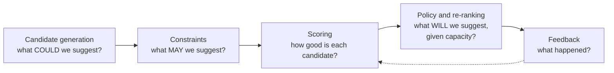

### 3.2 Collaborative filtering (CF)

**Intuition.** Learn from patterns *across* many users and items: reps who behave like you act on suggestions like
these. Toy rep × behaviour matrix (counts over a year):

| Rep | F2F → 1:1 email | Webinar → call | 1:1 click → call | Event → call |
|---|---:|---:|---:|---:|
| A | 12 | 0 | 5 | 3 |
| B | 10 | 0 | 4 | **0 → predicted high** |
| C | 0 | 6 | 0 | 0 |
| D | 1 | 5 | 0 | 1 |

Rep B behaves like Rep A on the first three behaviours, so CF predicts B would also act on *Event → call* suggestions,
even though B has never done it. Rep C has never emailed after F2F and resembles D, so CF predicts a low propensity.

**Explicit vs implicit feedback.** Ratings are explicit. Our data is mostly *implicit*: actions taken, opens, clicks.
Implicit data has no true negatives. A zero means "didn't happen", not "dislikes". The standard answer is **implicit ALS**
(Hu, Koren & Volinsky, 2008):

$$
\min_{X,Y}\; \sum_{u,i} c_{ui}\,\big(p_{ui} - x_u^\top y_i\big)^2 \;+\; \lambda\Big(\sum_u \lVert x_u\rVert^2 + \sum_i \lVert y_i\rVert^2\Big),
\qquad p_{ui} = \mathbb{1}[r_{ui} > 0],\quad c_{ui} = 1 + \alpha\, r_{ui}
$$

- $x_u$ and $y_i$ are $k$-dimensional embeddings (typically $k$ = 8–32) of user $u$ and item $i$. The score is their dot
  product.
- Every cell participates. Unobserved cells are weak negatives (confidence 1); observed cells are strong positives whose
  confidence grows with the count via $\alpha$.
- *Alternating least squares*: fix $Y$ and each $x_u$ has a closed form, then swap. This parallelises well, which is why
  Spark MLlib ships it (`ALS(implicitPrefs=True)`):

$$
x_u = \big(Y^\top C^u Y + \lambda I\big)^{-1} Y^\top C^u\, p(u)
$$

**Where the design uses CF** (details in §6.3):

1. **Rep × behaviour.** How each rep reacts to each kind of trigger, plus how they respond to suggestions (actioned or
   dismissed with a reason). This captures the strong rep effect [E11].
2. **HCP × engagement.** How each HCP engages by channel, action and content topic (1:M and 1:1 email, events, webinars,
   call reactions). This captures channel preference and topic interest, even for HCPs with sparse history.

**Why CF alone is not enough.** CF has no notion of *timing* (a call two days ago vs two months ago). It cannot express
constraints. It is weak for brand-new reps and HCPs (cold start). So CF output becomes *features* of a contextual model:
a **hybrid**.

Other CF families, for later: item-item kNN, BPR (pairwise ranking loss), two-tower neural retrieval, and sequence-aware
models such as SASRec / BERT4Rec over the event log.

### 3.3 Contextual models: trees that learn the thresholds

*Contextual filtering* means the score depends on features describing the situation at decision time. Gradient-boosted
decision trees (LightGBM / XGBoost) are the workhorse for tabular context, and they connect naturally to the current
rules. **Every split in a tree is a rule threshold, learned from data.** For example (illustrative numbers):

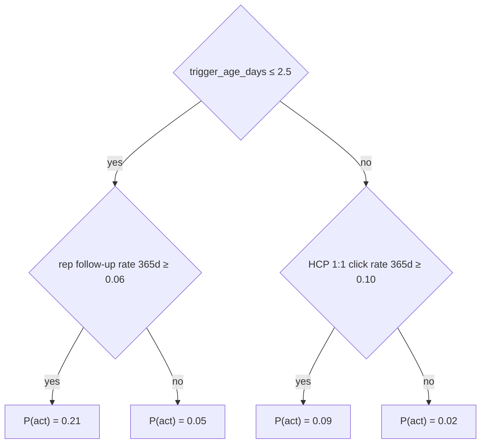

A hand-written rule is one tree with hand-picked splits and no weights. Boosting adds hundreds of small trees, each
fitted to the gradient of the loss left by the previous ones:

$$
F_m(x) = F_{m-1}(x) + \eta\, h_m(x), \qquad h_m \approx -\frac{\partial\, \ell(y, F)}{\partial F}\Big|_{F = F_{m-1}}
$$

What this buys us over rules:

- **Thresholds and interactions are learned.** For example, trigger age may matter more for Conversion HCPs than for
  Reach HCPs.
- **Domain knowledge is still enforceable** via *monotone constraints*. For example, $P(\text{act})$ must not increase as
  the trigger gets older.
- **Probabilities can be calibrated.** EV multiplies probabilities, so they must be calibrated (isotonic or Platt
  scaling on a held-out period).
- **Every suggestion is explainable.** SHAP values give per-suggestion drivers ("followed up within 3 days", "HCP clicks
  1:1 emails"). These feed the LLM reason (§7) and audits.

### 3.4 Hybrid recommenders

A *feature-level hybrid* feeds CF embeddings and affinities into the contextual model next to context features:

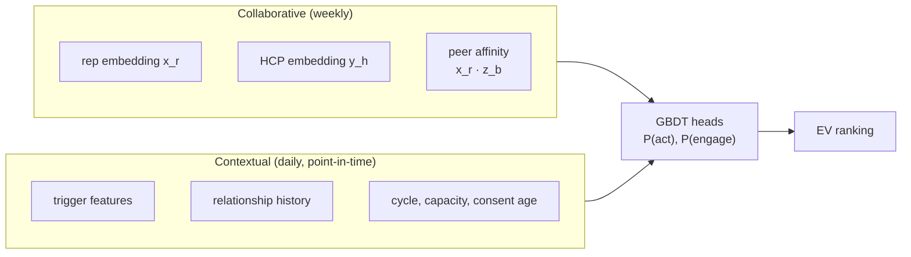

Why this shape:

- Context features carry *timing*.
- CF features carry *taste*.
- Side features (role, specialty, segment) handle cold start.
- The GBDT learns how to combine them.

Neural alternatives (Factorization Machines, DeepFM, Wide & Deep, two-tower models) can replace the GBDT later if data
volume justifies it.

### 3.5 Exploration, bandits and feedback loops

**The feedback-loop trap.** A model trained on the outcomes of its own suggestions only learns about what it already
shows. Candidates it never surfaces never get a chance to prove themselves, and the system converges on its own biases.

**Contextual bandits** formalise the fix. At each decision, observe context $x$, choose action $a$, and observe the reward
$r$ *only for the chosen action*. Common strategies:

- **ε-greedy:** explore uniformly with probability ε.
- **Thompson sampling:** sample from the posterior of each action's value.
- **LinUCB:** add an uncertainty bonus to linear estimates.

Our setting is a daily batch with a per-rep capacity, so the practical version is **exploration slots**:

- Reserve a small share (e.g. 5–10 %) of each rep's slots.
- Fill them by sampling from the eligible candidates not already chosen, with probability proportional to
  $\exp(EV/T)$ (§6.5).
- Log the propensity $\pi_0(a \mid x)$ of every published suggestion, exploit or explore.

Logged propensities are what make off-policy evaluation possible (§3.7). Historical *rule* logs are deterministic
(propensity 0 or 1), so they cannot be used for unbiased policy evaluation. Exploration fixes that going forward.

### 3.6 Causality, uplift and incrementality

E12 showed post-call emails get fewer clicks (3.9 %) than other 1:1 emails (6.4 %). Should we stop suggesting them?
**No: that comparison is confounded.** Emails sent without a recent call go to a different HCP population, likely
digitally engaged HCPs whom reps reach mainly by email.

The quantity we actually care about is the **uplift** of a suggestion:

$$
\tau(x) = \mathbb{E}\big[Y(1) - Y(0) \mid x\big]
$$

Here $Y(1)$ is the outcome if we suggest and $Y(0)$ the outcome if we don't. Only one of them is observed per case, so
uplift needs randomisation (A/B tests, exploration) or strong assumptions (all confounders measured). Estimators include
T-, S-, X- and DR-learners and causal forests.

**Design stance:**

- The MVP optimises EV with predictive models.
- Incrementality is **measured** with randomised experiments and the HCP hold-out (§8.5).
- Uplift *modelling* comes once randomised data exists (Phase 5).

### 3.7 Off-policy evaluation (OPE)

OPE estimates how a *new* policy $\pi$ would have performed, using logs from the *old* policy $\pi_0$, with no new
experiment:

$$
\hat V_{\text{IPS}} = \frac{1}{n}\sum_{i=1}^{n} \frac{\pi(a_i \mid x_i)}{\pi_0(a_i \mid x_i)}\, r_i
\qquad
\hat V_{\text{SNIPS}} = \frac{\sum_i w_i r_i}{\sum_i w_i},\; w_i = \frac{\pi(a_i \mid x_i)}{\pi_0(a_i \mid x_i)}
$$

$$
\hat V_{\text{DR}} = \frac{1}{n}\sum_{i=1}^{n} \Big[\hat q\big(x_i, \pi\big) + w_i\,\big(r_i - \hat q(x_i, a_i)\big)\Big]
$$

- **IPS** is unbiased but high-variance.
- **SNIPS** trades a little bias for much lower variance.
- **DR** (doubly robust) combines a reward model $\hat q$ with importance weights, and stays unbiased if either one is
  correct.
- **Requirement:** $\pi_0(a \mid x) > 0$ wherever $\pi(a \mid x) > 0$ (overlap). Hence exploration.
- **In practice:** clip large weights and report the effective sample size $(\sum w)^2 / \sum w^2$.

### 3.8 Point-in-time correctness (leakage)

Every feature must use only information available at the decision time $D$. The single most common way to fool yourself
with this kind of data is to compute features from today's snapshot and train on last year's triggers.

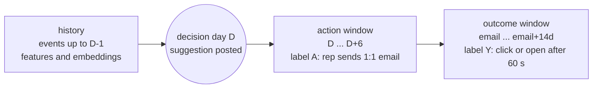

Leakage traps specific to our tables:

- **`it_comm_con_pd2_*` holds today's values** [E15e]. Joining them to historical triggers leaks the future. Recompute
  features from the event log with as-of joins, or snapshot daily from now on.
- **"Days since last email" must be computed as of $D$, not as of now.** Similarly, **`activity_date` in the call table
  can lie in the future** for planned calls [E1].
- **Suggestion outcomes (`actioned` / `dismissed`) are known only after $D$.** They can be features for *later*
  decisions, never for the same one.

On Databricks, the Feature Engineering client supports **point-in-time lookups** on time-series feature tables
(`FeatureLookup(..., timestamp_lookup_key=...)`). The same feature definitions serve training (as of history) and daily
scoring (as of today), which also eliminates train/serve skew.

---

## 4. Target architecture

### 4.1 Overview

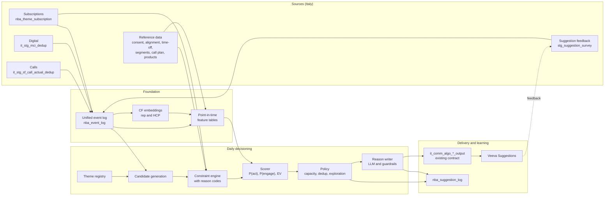

The architecture is the recommender funnel from §3.1 with a data foundation underneath. The key idea:
**triggers, labels and features are all events with keys and timestamps.** Once every interaction lives in one event log,
a theme config only has to *name* event types. Generic code then builds candidates, labels and features. That is what
removes per-rule SQL.

**Why a daily batch and not streaming.**

- Sources land daily, and the `pd2` consolidation job overwrites daily [E15e].
- Veeva Suggestions sync in batch.
- For post-call email, the same-day follow-ups a stream could catch (2.5 % of F2F calls [E10]) are exactly the ones reps
  already do on their own.

Near-real-time can be revisited for the digital → rep themes in Phase 3.

### 4.2 Components

| # | Component | Responsibility | Databricks building blocks | Cadence |
|---|---|---|---|---|
| 1 | Unified event log | Normalise all interactions. Attribute product. Deduplicate. Parse timestamps. Keep lineage | Delta (append / MERGE on source key), Spark | daily |
| 2 | Feature tables | Point-in-time aggregates keyed by (rep, HCP, product) and timestamp | UC Feature Engineering time-series feature tables | daily |
| 3 | CF embeddings | Implicit ALS on rep × behaviour and HCP × engagement | Spark MLlib `ALS`, MLflow | weekly |
| 4 | Theme registry | Versioned theme configs (§5) | YAML in Git → Delta table | on change |
| 5 | Candidate generation | Turn triggers into (rep, HCP, product, theme, trigger) candidates | Spark SQL driven by config | daily |
| 6 | Constraint engine | Declarative hard filters, each emitting a **reason code** (funnel audit) | Spark SQL | daily |
| 7 | Scorer | $P(\text{act})$, $P(\text{engage} \mid \text{act})$, EV | MLflow models from UC registry (`@champion`), `spark_udf` | daily |
| 8 | Policy | Capacity, dedup, routing, diversity, exploration, priority | Spark SQL window functions | daily |
| 9 | Reason writer | LLM title and reason, guardrails, template fallback | `ai_query()` / Foundation Model APIs | daily |
| 10 | Publisher | Write `it_comm_algo_<uuid>_output` in the existing schema | Spark | daily |
| 11 | Suggestion log | Full decision record: features hash, scores, propensity, explore flag, model and prompt versions, constraint trace | Delta | daily |
| 12 | Monitoring | Freshness, drift, KPIs, guardrail failure rates | Lakehouse Monitoring, AI/BI dashboards | daily / weekly |

### 4.3 The unified event log

| Column | Type | Description |
|---|---|---|
| `event_id` | string | deterministic hash of source table + source key (idempotent loads) |
| `event_ts` / `event_date` | timestamp / date | event time (fixed time-zone convention). `event_date` is the partition column |
| `loc_cd` | string | `IT` |
| `customer_id` | string | HCP (`001…`) |
| `employee_id` | string, nullable | rep (`005…`). NULL for 1:M digital events |
| `product_id` | string, nullable | attributed product (`a00…`). 1:M email is attributed via the Adobe campaign mapping [E5] |
| `event_family` | string | `CALL`, `EMAIL_1TO1`, `EMAIL_1TOM`, `EVENT`, `WEBINAR`, `WEB`, `SUGGESTION`, `SUBSCRIPTION` |
| `event_type` | string | e.g. `CALL_F2F`, `EMAIL_1TO1_DELIVERED`, `EMAIL_1TO1_CLICKED`, `EMAIL_1TOM_OPENED`, `EVENT_ATTENDED`, `SUGGESTION_POSTED`, `SUGGESTION_DISMISSED`, `THEME_UNSUBSCRIBED` |
| `channel` | string | source channel (`F2F`, `Web call`, `1:1 Email`, …) |
| `content_id` | string, nullable | MCI `CONTENT_ID`, presentation id or email template id |
| `attrs` | map<string,string> | e.g. `presentation_name`, `key_message_reaction`, `call_duration`, `dismiss_reason`, `open_latency_s` |
| `source_table`, `source_key` | string | lineage |

Source → event mapping:

| Source rows | Transformation | `event_type` |
|---|---|---|
| Calls, `Submitted_vod`, `activity_date <= as_of` | dedup to `call_id × product`. Map `channel_name` | `CALL_F2F`, `CALL_F2F_SHORT`, `CALL_REMOTE` (web call, virtual), `CALL_PHONE`, `CALL_OTHER` |
| MCI `1:1 Email` / `Delivered_vod`, `Opened_vod`, `Clicked_vod` | for opens, compute `open_latency_s` against the matching delivery | `EMAIL_1TO1_DELIVERED`, `…_OPENED`, `…_CLICKED` |
| MCI `1:1 Email` / `Bounced_vod`, `Unsubscribed_vod` | – | `EMAIL_1TO1_BOUNCED`, `…_UNSUBSCRIBED` |
| MCI `1:M Email-SFMC` / `Email_*` | product via `ADOBE_CAMPAIGN_PRODUCT_NAME` | `EMAIL_1TOM_DELIVERED`, `…_OPENED`, `…_CLICKED`, `…_BOUNCED`, `…_UNSUBSCRIBED` |
| MCI events / webinars | normalise `ACTION_NAME` | `EVENT_ATTENDED`, `WEBINAR_REGISTERED` |
| `stg_suggestion_survey` | one row per suggestion + one per outcome | `SUGGESTION_POSTED`, `…_ACTIONED`, `…_DISMISSED` (`attrs.reason`), `…_COMPLETED` |
| `nba_theme_subscription` | change events | `THEME_UNSUBSCRIBED`, `THEME_RESUBSCRIBED` |

Illustrative PySpark for one source (calls):

```python
calls_events = (
    spark.table("it_stg_sf_call_actual_dedup")
    .where("call_status = 'Submitted_vod' AND to_date(activity_date) <= current_date()")
    .groupBy("call_id", "customer_id", "employee_id", "product_id")          # call x product grain
    .agg(F.min(F.to_date("activity_date")).alias("event_date"),
         F.first("channel_name", ignorenulls=True).alias("channel"),
         F.first("presentation_name", ignorenulls=True).alias("presentation_name"),
         F.first("call_duration", ignorenulls=True).alias("call_duration"),
         F.collect_set("key_message_reaction").alias("key_message_reactions"))   # map to an ordinal scale later
    .withColumn("event_type", F.expr("""CASE channel WHEN 'F2F' THEN 'CALL_F2F'
                                                    WHEN 'F2F Short call' THEN 'CALL_F2F_SHORT'
                                                    WHEN 'Phone call' THEN 'CALL_PHONE'
                                                    WHEN 'Web call' THEN 'CALL_REMOTE'
                                                    WHEN 'Virtual' THEN 'CALL_REMOTE'
                                                    ELSE 'CALL_OTHER' END"""))
    .withColumn("event_id", F.sha2(F.concat_ws("|", F.lit("call"), "call_id", "customer_id", "employee_id",
                                               "product_id"), 256))   # 241 call x product keys have >1 HCP [E3e]
)
# MERGE INTO nba_event_log USING calls_events ON event_id  (idempotent daily upsert)
```

### 4.4 Jobs and cadence

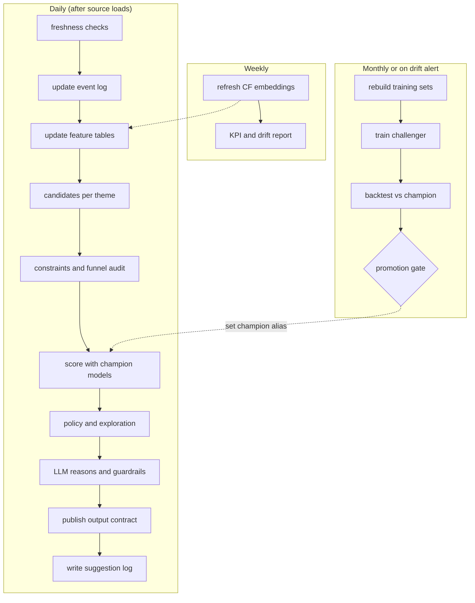

### 4.5 Reusing what already exists

| Existing asset | How it is reused |
|---|---|
| `it_comm_con_prdmstr_*`, `comm_con_bus_*` | `DIM_ID` and `BUS_*` codes for the output. Team and role lookups |
| `it_comm_con_pd2_*` | **Serving-time sanity check**: compare today's recomputed features with today's `pd2` values to catch bugs. Never used for training |
| Orchestrator notebooks and the Veeva push | Unchanged. A theme writes `it_comm_algo_<uuid>_output` like any rule |
| Email dismissal survey (`a1w4I0000043suhQAA`, reasons 1e–5e) | Referenced in `TAGS` so dismissal reasons stay comparable before and after |
| `team-algo-skills` / *algo-suggestion-diagnostics* | Constraint reason codes turn "why zero suggestions?" into one query on the funnel audit |

---

## 5. Themes as configuration

### 5.1 Anatomy of a theme

| Field | Purpose | Replaces in today's rules |
|---|---|---|
| `trigger` | Which event(s) create a candidate, keyed by (rep, HCP, product), plus a maximum age | `DAYS_SINCE_LAST_* <= N` |
| `recipient` | Who receives the suggestion (the trigger's rep, or aligned reps) | implicit in the metric table grain |
| `target_action` | The event that counts as "the rep acted" → label **A** | nothing. Never measured |
| `outcome` | The event that counts as "the HCP engaged" → label **Y** | nothing. Never measured |
| `hard_constraints` | Non-negotiable eligibility filters, each with a reason code | consent / DNC / bounce / time-off / survey-1e filters |
| `value_weight` | Business value of a successful action $v(h,p)$ | the RACE `CASE` weights |
| `models` | Registry aliases of the $P(\text{act})$ and $P(\text{engage})$ heads | the static score formula |
| `policy` | Capacity, exploration, priority | `QUALIFY rank <= 3` |
| `output` | Record type, lifespan, survey id, sub-algorithm code | `TAGS` literals |
| `reason` | LLM prompt id and fallback template id | `commentary_param_*` literals |

Notice what is **not** in the config: thresholds on `DAYS_SINCE_*` metrics, specialty or segment filters, and score
weights. Those are learned.

### 5.2 The MVP theme: `POST_CALL_EMAIL`

```yaml
theme_id: POST_CALL_EMAIL
version: 1
description: After a rep's call with an HCP, suggest a 1:1 approved-email follow-up
direction: rep_to_digital
market: IT

trigger:
  event_types: [CALL_F2F, CALL_F2F_SHORT, CALL_REMOTE, CALL_PHONE]   # the model learns short/phone calls rarely merit it
  keys: [employee_id, customer_id, product_id]                       # call x product grain
  max_age_days: 7          # candidate window = compute cap, NOT a tuned threshold (decay is learned)
  dedup: latest_trigger_per_key
  reconsider_unpublished: true   # a candidate that loses today's ranking may win tomorrow (with age+1)

recipient: trigger.employee_id
eligible_roles: [Rep]                                     # MSL are non-promotional; KAM optional (open question O8)

target_action:            # label A: did the rep act?
  event_type: EMAIL_1TO1_DELIVERED
  match: [employee_id, customer_id, product_id]           # 99 % of 1:1 emails carry a product [E4b]. Rep-HCP match if NULL
  window_days: 7                                          # from decision day D (= suggestion lifespan)

outcome:                  # label Y: did the HCP engage with that email?
  any_of:
    - event_type: EMAIL_1TO1_CLICKED
    - event_type: EMAIL_1TO1_OPENED
      where: "attrs.open_latency_s > 60"                   # drop machine opens [E12]
  match: [employee_id, customer_id, content_id]
  window_days: 14                                         # from the email

hard_constraints:                       # each emits a reason code for the funnel audit
  - {code: C01, rule: consent,              channel: Approved_Email_vod, value: "Y"}
  - {code: C02, rule: not_do_not_contact}
  - {code: C03, rule: no_hard_bounce,       lookback_days: 365}
  - {code: C04, rule: not_email_unsubscribed}
  - {code: C05, rule: dismiss_reason_suppression, reason: "1e", days: 90}    # HCP does not want emails
  - {code: C06, rule: rep_available,        next_days: 7, max_off_hours: 24}
  - {code: C07, rule: not_already_actioned, event_type: EMAIL_1TO1_DELIVERED, since: trigger}  # fixes "5e"
  - {code: C08, rule: subscribed}                                            # opt-out table (5.4)
  - {code: C09, rule: not_in_holdout,       enabled_when: experiment_uses_holdout}
  - {code: C10, rule: no_live_duplicate,    same: [employee_id, customer_id, theme_id]}

value_weight:             # business-owned. Illustrative values
  by: race_segment
  map: {Conversion: 1.0, Engagement: 0.9, Acquisition: 0.8, Reach: 0.6, default: 0.5}

models:
  p_act:    models:/rx_g_digital_fuel_commercial_prod001.nba_2_0.post_call_email_p_act@champion
  p_engage: models:/rx_g_digital_fuel_commercial_prod001.nba_2_0.post_call_email_p_engage@champion

policy:
  capacity: {per_rep_per_week: 4, per_rep_per_day: 2}    # starts near today's median email load [E8]
  one_per: [employee_id, customer_id]                    # best product wins. Others can be mentioned in the reason
  exploration_share: 0.10
  priority: Normal_vod                                   # keep constant in the pilot (test targeting, not labels)

output:
  record_type: Email_vod
  lifespan_days: 7
  suggestion_survey_id: a1w4I0000043suhQAA               # existing email dismissal survey (1e-5e)
  sub_algorithm_prefix: PCE_E_IT

reason:
  llm_prompt_id: post_call_email_it_v1
  fallback_template_id: post_call_email_it_tpl_v1
  language: it
```

### 5.3 How the other themes plug in

| Theme | Direction | Trigger | Recipient | Label A (rep acts) | Label Y (HCP engages) | Record type |
|---|---|---|---|---|---|---|
| **POST_CALL_EMAIL** (MVP) | rep → digital | `CALL_*` | calling rep | 1:1 email ≤ 7 d | click / open > 60 s ≤ 14 d | Email_vod |
| EMAIL_ENGAGEMENT_TO_REP | digital → rep | `EMAIL_1TOM_CLICKED`, `EMAIL_1TO1_CLICKED` (opens as weaker triggers) | aligned rep(s) for HCP × product | call or 1:1 email ≤ 7 d | next HCP engagement ≤ 14 d | Insight_vod / Call_vod |
| EVENT_FOLLOWUP | event → rep | `EVENT_ATTENDED`, `WEBINAR_REGISTERED` | aligned rep(s) | call ≤ 14 d | positive key-message reaction / click | Call_vod |
| NO_RESPONSE_SWITCH | digital → rep | *absence:* 1:1 email not opened after N days | sending rep | call / other channel ≤ 7 d | engagement ≤ 14 d | Call_vod |
| REENGAGE | plan → rep | *absence:* no contact vs cycle pacing | aligned rep | call ≤ 14 d | call with positive reaction | Call_vod |

Two mechanisms make all of these work without theme-specific SQL:

1. **Routing for HCP-level triggers.** 1:M digital events carry no rep [E4b], and Italy has no owner table [E15c]. Route
   through `stg_alignment` → territory → `stg_territory_salesrep_hierarchy`, restricted to reps whose team carries the
   product. When several reps qualify (28 % of HCPs are multi-rep [E15b]), the policy keeps one suggestion per HCP ×
   product. It goes to the rep with the highest $P(\text{act})$, with the last caller for the product as tie-break.
2. **Absence triggers.** "Nothing happened" is not an event. A scheduled *absence detector* writes synthetic events
   (e.g. `EMAIL_1TO1_NO_OPEN_7D`, `NO_CONTACT_VS_PLAN`) into the event log. From then on they are ordinary triggers.

A new theme is mostly a diff against the MVP config:

```yaml
theme_id: EMAIL_ENGAGEMENT_TO_REP
direction: digital_to_rep
trigger:   {event_types: [EMAIL_1TOM_CLICKED, EMAIL_1TO1_CLICKED], keys: [customer_id, product_id], max_age_days: 5}
recipient: {route: alignment, product_team_match: true, tie_break: [p_act, last_caller_for_product]}
target_action: {event_types: [CALL_F2F, CALL_REMOTE, EMAIL_1TO1_DELIVERED], match: [employee_id, customer_id], window_days: 7}
outcome:       {event_types: [EMAIL_1TO1_CLICKED, POSITIVE_KEY_MESSAGE_REACTION], match: [customer_id], window_days: 14}
output:        {record_type: Insight_vod, lifespan_days: 5}
```

### 5.4 Subscriptions (opt-out)

Everything is on by default. A rep can unsubscribe from a theme for one HCP, for a product, or entirely. The UI is out of
scope. It writes to this table, and the engine only reads it.

| Column | Type | Notes |
|---|---|---|
| `employee_id` | string | rep (`005…`) |
| `theme_id` | string | e.g. `POST_CALL_EMAIL` |
| `customer_id` | string, nullable | NULL = all of the rep's HCPs |
| `product_id` | string, nullable | NULL = all products |
| `status` | string | `UNSUBSCRIBED` / `SUBSCRIBED` (explicit re-subscribe) |
| `source` | string | `REP_UI` / `AUTO_MUTE` / `ADMIN` |
| `reason_code` | string, nullable | optional, e.g. a dismissal reason for auto-mutes |
| `effective_from`, `effective_to` | timestamp | `effective_to` NULL = open-ended |
| `updated_at` | timestamp | |

**Resolution rule:** the most specific matching row wins (HCP before product before theme-wide). With no row, the default
is `SUBSCRIBED`.

```sql
WITH matched AS (
  SELECT c.candidate_id, s.status,
         ROW_NUMBER() OVER (PARTITION BY c.candidate_id
                            ORDER BY (s.customer_id IS NOT NULL) DESC,
                                     (s.product_id  IS NOT NULL) DESC,
                                     s.updated_at DESC) AS rn
  FROM candidates c
  JOIN nba_theme_subscription s
    ON  s.employee_id = c.employee_id
    AND s.theme_id    = c.theme_id
    AND (s.customer_id IS NULL OR s.customer_id = c.customer_id)
    AND (s.product_id  IS NULL OR s.product_id  = c.product_id)
    AND current_timestamp() >= s.effective_from
    AND (s.effective_to IS NULL OR current_timestamp() < s.effective_to)
)
SELECT c.*, COALESCE(m.status, 'SUBSCRIBED') AS subscription_status      -- opt-out default
FROM candidates c
LEFT JOIN matched m ON m.candidate_id = c.candidate_id AND m.rn = 1;
```

**Auto-mute (proposal).** Repeated dismissals turn into a temporary, visible and reversible mute. Example: two "4e: not
appropriate for this HCP" for the same rep × HCP × theme within 90 days → `AUTO_MUTE` for 180 days. A "3e: bad period"
dismissal → 30 days. The parameters are illustrative and should be agreed with the business.

**Subscriptions are also data:**

- A rep × theme unsubscription is a strong explicit negative for that rep in the CF matrix.
- A rep × HCP unsubscription is a hard filter.
- The **opt-out rate** is a guardrail KPI. With an opt-out default, notification fatigue is the main adoption risk, so
  capacity caps matter (§6.5, §8.5).

### 5.5 Theme lifecycle

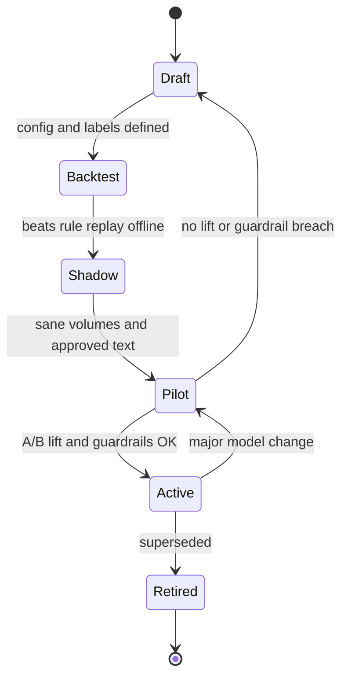

**Adding a theme, step by step:**

1. Write the config.
2. Make sure its event types exist in the event log.
3. Run the generic label builder to get base rates, the decay curve and rep heterogeneity (as in §2.3).
4. Train the heads, or add the theme as a feature to a shared multi-theme model once there are 3 or more themes.
5. Backtest against the rule replay.
6. Shadow.
7. Pilot.

No threshold SQL is written at any step.

---

## 6. Algorithms

### 6.1 Formalisation

The engine decides once per day $D$, using data up to $D-1$. A **candidate** is
$x = (r, h, p, \theta, e)$: rep $r$, HCP $h$, product $p$, theme $\theta$ and trigger event $e$ (e.g. a call on day $t$).

- **Label $A$ (rep acts):** $r$ sends a 1:1 email about $p$ to $h$ within $[D, D+6]$, the suggestion lifespan.
- **Label $Y$ (HCP engages):** $h$ clicks that email, or opens it more than 60 s after delivery, within 14 days.

$$
EV(x) \;=\; \underbrace{P(A=1 \mid x)}_{\text{head 1: rep acts}} \;\times\; \underbrace{P(Y=1 \mid A=1, x)}_{\text{head 2: HCP engages}} \;\times\; \underbrace{v(h,p)}_{\text{business value}}
$$

Why the product of the two heads:

| Rank by | What happens | Failure mode |
|---|---|---|
| $P(A)$ only | suggests what reps would do anyway | "obvious" nudges, little incremental value, rep fatigue |
| $P(Y \mid A)$ only | suggests the most responsive HCPs | reps ignore it (low adoption), dismissals rise |
| $v$ only (today's rules) | ranks by RACE segment | blind to both rep and HCP behaviour |
| **EV** | balances adoption, impact and business priority | needs calibrated probabilities (§6.4) |

**Incremental extension (Phase 5).** A suggestion is worth most for reps who would *not* have acted without it. Let
$s \in \{0,1\}$ denote "suggestion shown":

$$
EV^{\text{incr}}(x) = \big[P(A=1 \mid x, s=1) - P(A=1 \mid x, s=0)\big] \cdot P(Y=1 \mid A=1, x) \cdot v(h,p)
$$

A convenient parametrisation is the *noisy-OR* model:
$P(A \mid x, s=1) = 1 - \big(1 - P(A \mid x, s=0)\big)\big(1 - q(x)\big)$. Here $q(x)$ is the probability that the
nudge alone triggers the action. $P(A \mid x, s=0)$ is learned from the large natural (unsuggested) data, and $q(x)$ from
exposure logs. Exploration makes $q(x)$ identifiable.

### 6.2 Training data (point-in-time)

Three datasets, all built by generic code from the event log and the theme config.

**(1) Imitation set: every trigger, not just the ones a rule fired on.** Each historical call becomes a training example:
"did the rep follow up?". This is far richer than the suggestion log. It covers about 413K F2F calls in the 13-month window [E9] instead of about
27K email suggestions a year [E6b], and it is not limited to cases the old thresholds selected.

- *Decision-day sampling.* For each trigger on day $t$, draw one decision day $D \in [t+1, t+7]$. This mirrors serving,
  where candidates of every age compete, and lets the model learn the age decay directly.
- *Exclude already-actioned triggers*, i.e. an email between $t$ and $D-1$ (constraint C07). The same-day follow-ups
  (2.5 % of F2F calls [E10]) are exactly these.
- *Label:* $A = 1$ if the first email after the trigger falls in $[D, D+6]$. The expected base rate is about 5 %, given
  that roughly 5.2 % of F2F calls see a first email on days 1–7 [E10].
- *Repeat visits:* if the rep calls the HCP again, the later call becomes its own trigger. Each email is attributed to the
  most recent preceding call (the day-7 bump in §2.3).

**(2) Exposure set: the actual suggestions.** These are the 26,672 Email_vod suggestions a year [E6b], with explicit
outcomes (`actioned` / `dismissed` + reason) and a behavioural check (was an email really delivered within the lifespan?).
They give $s = 1$ examples. The MVP trains head 1 on the union of (1) and (2), with an indicator `suggested` and a
`rule_would_fire` feature (the replayed old rule), and scores with `suggested = 1`.

> **Caveat (overlap):** rules only fired in narrow regions (e.g. last email ≥ 28 days ago), so the `suggested` effect is
> learned only there. Check calibration of $P(A \mid s=1)$ on held-out exposures, and rely on exploration and the A/B test
> to learn the effect elsewhere.

**(3) Engagement set: delivered 1:1 emails.** About 66K a year, 37K of them post-call [E12]. Features are taken at send
time, plus trigger features when the email follows a call. Labels are click (5.0 %) and open after 60 s (42.0 %).

- **Use two classifiers.** $P(\text{open}_{>60s})$ (dense) and $P(\text{click})$ (rare). Combine them into expected
  engagement units, e.g. $u = P(\text{open}_{>60s}) + \beta\,P(\text{click})$ with $\beta \approx 3$, agreed with the
  business.
- **Correct for selection bias.** Reps choose whom to email, so the sent population is skewed toward responsive HCPs.
  Re-weight training rows by $w = 1 / \text{clip}\big(\hat P(A=1 \mid x), 0.02, 1\big)$ (inverse propensity weighting),
  using head 1 as the propensity model.

Illustrative PySpark for dataset (1):

```python
from pyspark.sql import functions as F

SCHEMA = "rx_g_digital_fuel_commercial_prod001.nba_2_0"
ev = spark.table(f"{SCHEMA}.nba_event_log")

triggers = (ev.where(F.col("event_type").isin("CALL_F2F", "CALL_F2F_SHORT", "CALL_REMOTE", "CALL_PHONE"))
              .join(rep_dim.where("role = 'Rep'").select("employee_id"), "employee_id")
              .select(F.col("event_id").alias("trigger_id"), "employee_id", "customer_id", "product_id",
                      F.col("event_date").alias("trigger_date"), "channel", "attrs"))

emails = (ev.where("event_type = 'EMAIL_1TO1_DELIVERED'")
            .select("employee_id", "customer_id", "product_id", F.col("event_date").alias("email_date")))

cand = (triggers
        .withColumn("age", (F.floor(F.rand(seed=7) * 7) + 1).cast("int"))      # decision-day sampling, 1..7
        .withColumn("D", F.expr("date_add(trigger_date, age)")))

c, e = cand.alias("c"), emails.alias("e")
first_email = (c.join(e, (F.col("c.employee_id") == F.col("e.employee_id"))
                         & (F.col("c.customer_id") == F.col("e.customer_id"))
                         & (F.col("c.product_id").eqNullSafe(F.col("e.product_id")) | F.col("e.product_id").isNull())
                         & F.col("e.email_date").between(F.col("c.trigger_date"), F.expr("date_add(c.D, 6)")),
                  "left")                                                         # window in the JOIN, not a WHERE
               .groupBy(F.col("c.trigger_id").alias("trigger_id"))
               .agg(F.min("e.email_date").alias("first_email_date")))

dataset = (cand.join(first_email, "trigger_id")
           .where("first_email_date IS NULL OR first_email_date >= D")           # drop already actioned (C07)
           .withColumn("label_A", F.col("first_email_date").isNotNull().cast("int"))
           .withColumn("as_of_ts", F.expr("CAST(date_sub(D, 1) AS TIMESTAMP)")))  # features strictly before D

# Point-in-time features: the same definitions are used for daily scoring (no train/serve skew)
from databricks.feature_engineering import FeatureEngineeringClient, FeatureLookup
fe = FeatureEngineeringClient()
training_set = fe.create_training_set(
    df=dataset,
    feature_lookups=[
        FeatureLookup(table_name=f"{SCHEMA}.ft_rep_hcp_daily", lookup_key=["employee_id", "customer_id"],
                      timestamp_lookup_key="as_of_ts"),
        FeatureLookup(table_name=f"{SCHEMA}.ft_hcp_daily", lookup_key="customer_id", timestamp_lookup_key="as_of_ts"),
        FeatureLookup(table_name=f"{SCHEMA}.ft_rep_daily", lookup_key="employee_id", timestamp_lookup_key="as_of_ts"),
        FeatureLookup(table_name=f"{SCHEMA}.ft_cf_embeddings_weekly", lookup_key="employee_id",
                      timestamp_lookup_key="as_of_ts"),
    ],
    label="label_A",
    exclude_columns=["first_email_date"],
)
```

Two refinements are left out of the sketch for readability. Both are cheap window functions over (rep, HCP) ordered by
`trigger_date`:

- **Attribution:** end each trigger's label window the day before the *next* call by the same rep to the same HCP, i.e.
  $\min(D+6,\ t_{\text{next}}-1)$. An email after a repeat visit then counts for the most recent call only.
- **Superseded triggers:** drop sampled decision days $D > t_{\text{next}}$. At serving time `dedup: latest_trigger_per_key`
  replaces the older trigger with the newer one.

### 6.3 The collaborative component

**(a) Rep × behaviour matrix.** Rows are reps (about 350). Columns are behaviours, built from the event log over a
trailing 365 days as of each weekly snapshot:

| Column family | Example column | Cell value |
|---|---|---|
| trigger → response | `CALL_F2F · Trelegy → EMAIL_1TO1 ≤ 7d` | count |
| trigger → response | `EMAIL_1TO1_CLICKED → CALL ≤ 7d` (Phase 3) | count |
| suggestion feedback | `POST_CALL_EMAIL → ACTIONED` | count |
| suggestion feedback | `POST_CALL_EMAIL → DISMISSED_4e` | count |
| subscriptions | `POST_CALL_EMAIL → UNSUBSCRIBED_HCP` | count |

Dismissals and unsubscriptions become their own columns ("behaviours"). Implicit ALS cannot model negative values, but
it *can* learn that reps who dismiss with 4e resemble each other.

**(b) HCP × engagement matrix.** Rows are HCPs (about 100K). Columns are channel · action · topic, for example
`EMAIL_1TOM_CLICKED · Respiratory`, `EMAIL_1TO1_OPENED>60s · Trelegy`, `EVENT_ATTENDED · Oncology`, `CALL_F2F · Shingrix`
and `KM_REACTION_POSITIVE · Nucala`.

**Features derived for the GBDT:**

- **Raw embeddings** $x_r, y_h$ (small $k$, e.g. 16). Trees handle them adequately; they mostly act as cluster ids.
- **Affinity scores:** $x_r^\top z_b$ for the behaviour column $b$ matching the candidate (e.g.
  `CALL_F2F · <product> → EMAIL_1TO1 ≤ 7d`). This is the *peer-smoothed propensity*: what reps like this one do in this
  situation.
- **HCP channel affinity:** $y_h^\top z_c$ for the column $c$ = `EMAIL_1TO1_CLICKED · <product>`.
- **kNN peer rate:** the average follow-up rate of the 10 most similar reps (cosine on $x_r$) for the same channel ×
  product.

**Cold start:** zero vector plus an `is_cold` flag. Side features (team, role, specialty, segment) carry the signal.

**Point in time:** embeddings are snapshotted weekly, and training rows use the latest snapshot before $D$.

> **Empirical-Bayes smoothing, the poor man's CF.** For any per-rep or per-HCP rate, use
> $\tilde\rho = \frac{k + m\,\rho_0}{n + m}$ ($k$ successes in $n$ trials, prior $\rho_0$ = team rate, strength $m$).
> A rep with 3 F2F calls and 0 follow-ups gets roughly the team rate, not 0. Reps vary from 0.5 % to 15.6 % [E11], so
> this alone is a strong feature.

```python
from pyspark.ml.recommendation import ALS

als = ALS(userCol="rep_idx", itemCol="behaviour_idx", ratingCol="count",
          implicitPrefs=True, rank=16, regParam=0.1, alpha=20.0,      # tune alpha on held-out behaviours
          maxIter=15, nonnegative=False, coldStartStrategy="drop", seed=42)
model = als.fit(rep_behaviour_counts)          # long format: (rep_idx, behaviour_idx, count), trailing 365 d as of snapshot
rep_factors = model.userFactors                # -> ft_cf_embeddings_weekly (with snapshot_ts)
behaviour_factors = model.itemFactors          # used for affinity features x_r . z_b
```

*Validating CF on its own:* hold out 20 % of each rep's non-zero cells and measure recall@k / NDCG@k of the reconstructed
matrix. If CF features do not lift the GBDT in the ablation (§8.2), drop them. They earn their place empirically.

> Rep embeddings are used for **ranking only**. Never surface rep-vs-peer comparisons in the suggestion text; that is an
> HR-sensitive area.

### 6.4 The contextual model

Two LightGBM binary classifiers (head 1: $A$; head 2: open after 60 s and click). MVP feature families:

| Family | Example features | Source |
|---|---|---|
| Trigger | channel, call type, duration, CLM used, # key messages, presentation (target-encoded), best key-message reaction, # products detailed, accompanied, **trigger age (days)**, weekday | call events |
| Rep–HCP relationship | calls 30/90/365 d, days since the previous call, 1:1 emails 90/365 d, days since the last 1:1 email, last email opened after 60 s / clicked, smoothed rep-HCP follow-up rate | event log |
| HCP | RACE segment, specialty, persona / attitudinal segment, consent age, 1:M open-after-60s and click rates 90/365 d, 1:1 engagement rates, events attended, # reps covering, $y_h$, channel affinity | event log, segments, CF |
| Rep | team, # HCPs called 90 d, smoothed follow-up rate, workload (calls last 7 d, live suggestions), time-off next 7 d, acceptance rate and dismissal-reason mix, $x_r$, peer affinity | event log, survey, CF |
| Product / cycle | product, product priority, days since cycle start / to cycle end, call-plan attainment, approved templates available (if a source exists, see O9) | call plan, product tables |
| Suggestion history | suggestions rep-HCP 30 d, days since last dismissal by reason (2e/3e/4e), days since last actioned, `rule_would_fire`, `suggested` (training only) | survey events |
| Calendar | month, week of year, Italian holiday window, August flag | calendar |

Training recipe:

1. **Rolling-origin time splits.** For example train ≤ month $m$, validate $m+1$, test $m+2$. Never split randomly; days
   leak across rows.
2. **Monotone constraints** where domain logic is unambiguous: head 1 is non-increasing in trigger age. Leave
   "days since last email" free, because fatigue (too recent) and drift (too long ago) pull in opposite directions.
3. **Calibrate** with isotonic regression on a later slice. EV multiplies probabilities, so miscalibration distorts the
   ranking between reps.
4. **Explain** with SHAP (`pred_contrib=True`). Take the top-3 positive contributions per suggestion and map them through
   a feature → phrase dictionary to give the facts for the LLM (§7).
5. **Track** everything in MLflow and register in Unity Catalog. The policy only ever loads `@champion`.

```python
import lightgbm as lgb, mlflow
from sklearn.isotonic import IsotonicRegression
from sklearn.metrics import average_precision_score

mono = [-1 if c == "trigger_age_days" else 0 for c in feature_cols]
params = dict(objective="binary", learning_rate=0.03, num_leaves=63, min_data_in_leaf=200,
              feature_fraction=0.8, bagging_fraction=0.8, bagging_freq=1, lambda_l2=1.0,
              monotone_constraints=mono, monotone_constraints_method="advanced", verbose=-1)

with mlflow.start_run(run_name="post_call_email_p_act"):
    d_tr = lgb.Dataset(X_tr, y_tr, categorical_feature=cat_cols)
    d_va = lgb.Dataset(X_va, y_va, categorical_feature=cat_cols, reference=d_tr)
    booster = lgb.train(params, d_tr, num_boost_round=3000, valid_sets=[d_va],
                        callbacks=[lgb.early_stopping(100)])
    iso = IsotonicRegression(out_of_bounds="clip").fit(booster.predict(X_cal), y_cal)   # later time slice
    p_te = iso.predict(booster.predict(X_te))
    mlflow.log_metrics({"pr_auc_test": average_precision_score(y_te, p_te)})
    # log booster + calibrator as one pyfunc model, register to UC, then set alias "challenger"
```

### 6.5 Policy: from scores to suggestions

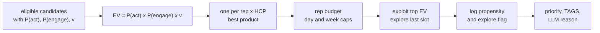

1. **EV and floor.** Compute $EV$. Optionally drop $EV < \tau$. This is the *only* threshold, and it is chosen on
   backtests to hit a target precision, not guessed.
2. **One per rep × HCP.** Keep the best product. Other products can be mentioned in the reason.
3. **Capacity.** A per-rep daily and weekly budget for the theme, starting near today's email load (median 4 per
   rep-week [E8]). From Phase 3, a shared budget across themes is allocated greedily by EV.
4. **Exploration.** With probability ε the last slot is sampled ∝ $\exp(EV/T)$ from the remaining pool. Log the
   *exact* propensity used.
5. **Next-day reconsideration.** Unpublished candidates compete again tomorrow with age + 1, so the learned decay
   handles priority. Published ones are blocked by C10 for their lifespan.
6. **Priority.** Hold `Normal_vod` constant in the pilot so the experiment tests targeting, not labels. An EV-quantile
   → `Urgent_vod` mapping is a separate later experiment.

```sql
-- exploit part (per day); exploration of the last slot happens in Python with logged propensities
WITH scored AS (
  SELECT *, p_act * p_engage * value_weight AS ev
  FROM candidates_scored
  WHERE constraints_passed                                    -- all hard constraints, see funnel audit
),
best_per_pair AS (
  SELECT * FROM scored
  QUALIFY ROW_NUMBER() OVER (PARTITION BY employee_id, customer_id ORDER BY ev DESC) = 1
),
budget AS (
  SELECT employee_id, LEAST(:per_rep_per_day, :per_rep_per_week - published_this_week) AS slots
  FROM rep_capacity
)
SELECT b.*, k.slots, ROW_NUMBER() OVER (PARTITION BY b.employee_id ORDER BY b.ev DESC) AS rk
FROM best_per_pair b
JOIN budget k USING (employee_id)
WHERE k.slots > 0;
```

```python
import numpy as np, pandas as pd

def select_for_rep(cands: pd.DataFrame, slots: int, eps=0.10, temp=0.05, rng=None) -> pd.DataFrame:
    """cands: one row per HCP (best product) with column 'ev'. Returns published rows with exact propensities."""
    rng = rng or np.random.default_rng()
    ranked = cands.sort_values("ev", ascending=False).reset_index(drop=True)
    if slots <= 0 or ranked.empty:
        return ranked.iloc[0:0]
    if len(ranked) <= slots:                                                  # nothing to explore
        return ranked.assign(explored=False, propensity=1.0)
    fixed = ranked.iloc[: slots - 1].assign(explored=False, propensity=1.0)   # always published
    pool = ranked.iloc[slots - 1:]                                            # competes for the last slot
    w = np.exp((pool["ev"].to_numpy() - pool["ev"].max()) / temp)
    probs = (1 - eps) * np.eye(len(pool))[0] + eps * w / w.sum()               # greedy / softmax mixture
    j = rng.choice(len(pool), p=probs)
    last = pool.iloc[[j]].assign(explored=bool(j != 0), propensity=float(probs[j]))
    return pd.concat([fixed, last], ignore_index=True)
```

### 6.6 Scale (back of the envelope)

- **Triggers:** roughly 1.5–2K Rep calls per working day [E2, E9], 1.35 products per call on average [E3d], and a 7-day
  window. That is at most a few tens of thousands of live candidates per day before constraints. Trivial for Spark and
  LightGBM.
- **Training:** about 13 months of triggers is roughly 0.5–1 M rows with decision-day sampling. Minutes on one node.
- **ALS:** 350 × a few thousand behaviours, and 100K HCPs × a few hundred columns. Minutes.
- **LLM:** at most the published suggestions (a few hundred per day). Negligible cost and latency.

### 6.7 Model options considered

| Option | Strengths | Weaknesses | Verdict |
|---|---|---|---|
| Status-quo rules | transparent, no ML ops | guessed thresholds, no learning, notebook sprawl | keep for compliance and informational insights |
| Heuristic score (recency × RACE) | trivial | ignores rep and HCP behaviour | baseline B1 / B2 |
| CF only (ALS) | captures rep and HCP "taste" | no timing, no constraints, cold start | used as features |
| Context-only GBDT | strong on tabular data, explainable | no peer smoothing for sparse reps / HCPs | ablation baseline B4 |
| **Hybrid GBDT + CF features** | best of both, explainable, cheap | two artefacts to maintain | **MVP choice** |
| FM / DeepFM / two-tower | end-to-end interactions | more data, less transparent | Phase 5 candidate |
| Sequence transformer over event log | long-range patterns, next-action prediction | data hungry, harder to explain | Phase 5 research |
| Multi-step RL | optimises long-term value | needs a simulator or rich off-policy data | long term |

---

## 7. LLM-generated suggestion text

### 7.1 Division of labour

| The LLM may | The LLM must not |
|---|---|
| choose which of the provided facts to emphasise | invent facts (dates, numbers, names, content) |
| phrase them fluently and concisely in Italian | make clinical, efficacy or safety claims, or mention indications |
| adapt tone to the theme (follow-up, insight, reminder) | reference content that is not in the payload |
| | include personal data (HCP or patient) or compare reps |

The suggestion is attached to the HCP's account in Veeva, so the text never needs the HCP's name. The model therefore
never sees it.

### 7.2 Facts-only payload

Every date and number is pre-formatted as a display string, and the prompt requires verbatim use. That makes the grounding
check a simple string test (§7.5).

```json
{
  "theme": "POST_CALL_EMAIL",
  "language": "it",
  "product": "Trelegy",
  "trigger": {"date": "21/10/2026", "channel": "visita F2F", "presentation": "TRELEGY COPD eDet CES 2025"},
  "last_1to1_email": {"date": "14/07/2026", "name": "<nome e-mail approvata>"},
  "drivers": [
    {"code": "RECENT_CALL",          "text": "visita effettuata 2 giorni fa"},
    {"code": "HCP_EMAIL_RESPONSIVE", "text": "l'OS ha aperto 3 delle ultime 4 e-mail 1:1"},
    {"code": "NO_RECENT_EMAIL",      "text": "nessuna e-mail 1:1 negli ultimi 90 giorni"}
  ],
  "limits": {"title_max_chars": 80, "reason_max_chars": 350}
}
```

The `drivers` are the top SHAP contributions (§6.4) mapped through an approved feature → phrase dictionary. The LLM
selects and phrases them; it does not compute them.

### 7.3 Prompt (outline)

```text
[system]
Sei un assistente che scrive suggerimenti brevi per informatori scientifici GSK in Italia.
Regole:
1. Usa SOLO i fatti presenti nel JSON. Copia date e numeri esattamente come scritti. Non aggiungere nulla.
2. Nessuna affermazione clinica, di efficacia o di sicurezza. Non citare indicazioni terapeutiche.
3. Nessun dato personale e nessun confronto con colleghi.
4. Tono professionale e neutro, senza superlativi. Usa "OS" per l'operatore sanitario.
5. Rispondi solo con JSON {"title": ..., "reason": ...} rispettando i limiti di lunghezza.
[few-shot examples approved by Medical/Legal/Regulatory (MLR)]
[user]
FATTI: <payload JSON>
```

*(English gist: use only the facts and copy dates and numbers verbatim; no clinical, efficacy or safety claims; no
personal data or peer comparisons; neutral tone; JSON output within the length limits.)*

### 7.4 Batch execution on Databricks

At most a few hundred suggestions are published per day, so a single batched SQL statement is enough.

```sql
SELECT s.suggestion_uid,
       ai_query(
         '<approved-foundation-model-endpoint>',
         CONCAT(:system_prompt, '\n\nFATTI:\n', to_json(s.facts)),
         modelParameters => named_struct('temperature', 0.0, 'max_tokens', 300),
         responseFormat  => '{"type":"json_schema","json_schema":{"name":"reason","strict":true,
                              "schema":{"type":"object","properties":{"title":{"type":"string"},
                              "reason":{"type":"string"}},"required":["title","reason"]}}}',
         failOnError     => false
       ) AS llm_out
FROM nba_publish_candidates s;
```

Check the parameter names against the `ai_query` documentation for your runtime. Use a workspace-hosted endpoint
approved under GSK AI policy (open question O5), ideally behind AI Gateway for logging and rate limits.

### 7.5 Guardrail pipeline

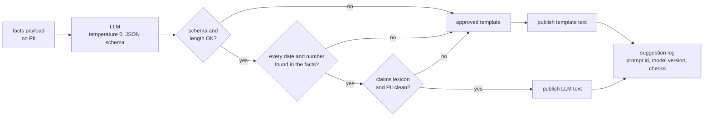

```python
import json, re

# Illustrative lexicon. The real list is owned by Compliance and versioned with the prompt.
BANNED = re.compile(r"\b(efficac\w*|sicur\w*|miglior\w*|superior\w*|garanti\w*|guari\w*|off[- ]?label|pazient\w*)\b", re.I)
PII = re.compile(r"[\w.+-]+@[\w-]+\.\w+|\+?\d[\d\s]{7,}\d")                 # e-mail addresses, phone numbers
TOKENS = re.compile(r"\d{1,2}/\d{1,2}/\d{4}|\d+(?:[.,]\d+)?")             # dates first, then plain numbers

def validate(llm_out: str, facts: dict, max_title: int = 80, max_reason: int = 350):
    """Return (text, status). text is None when the template fallback must be used."""
    try:
        out = json.loads(llm_out)
        title, reason = out["title"].strip(), out["reason"].strip()
    except (ValueError, KeyError, TypeError, AttributeError):
        return None, "SCHEMA"
    if not (0 < len(title) <= max_title and 0 < len(reason) <= max_reason):
        return None, "LENGTH"
    text = f"{title} {reason}"
    if BANNED.search(text):
        return None, "CLAIMS_LEXICON"
    if PII.search(text):
        return None, "PII"
    facts_tokens = set(TOKENS.findall(json.dumps(facts, ensure_ascii=False)))
    if any(tok not in facts_tokens for tok in TOKENS.findall(text)):         # grounding: copy-verbatim rule
        return None, "UNGROUNDED_TOKEN"
    return {"title": title, "reason": reason}, "OK"
```

Grounding compares *extracted tokens*, not substrings, so a hallucinated "5" does not pass just because "2025" appears in
the facts. Note that "1:1" in "e-mail 1:1" tokenises to the numbers `1` and `1`, which are grounded because the payload
contains the same phrase. The check is deliberately strict: a false alarm only costs a fallback to the template.

### 7.6 Template fallback

The approved template mirrors today's rule commentary, so a fallback is never worse than the status quo:

```text
TITLE_VOD__C: Suggerimento: considera di inviare una 1:1 e-mail
COMMENTARY:   In data {trigger.date} hai visitato l'OS per {product}.
              <li>Ultima e-mail 1:1 inviata: {last_1to1_email.name} il {last_1to1_email.date}</li>
```

### 7.7 Governance

- **MLR approval before the pilot:** the system prompt, few-shot examples, lexicon, phrase dictionary and template, all
  versioned (`prompt_id`). Any change means re-approval.
- **Sample-based human review** of published texts during the pilot, plus monitoring of the fallback rate by reason code.
  A rising `UNGROUNDED_TOKEN` rate means the prompt or model drifted.
- **Experimentable:** "LLM text vs template" can be an A/B factor of its own. Compare acceptance and dismissal reasons.
- **Full traceability:** every published text is logged with its payload, endpoint and model version, prompt id and
  check results.

---

## 8. Evaluation

### 8.1 The evaluation ladder

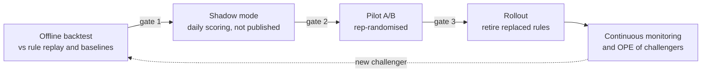

| Gate | Pass criteria (proposal) |
|---|---|
| 1. Offline → shadow | Hybrid beats rule replay (B2) on Value@k on every test fold. Calibration ECE ≤ 0.02. No slice (product, RACE, channel) worse than B2 by a material margin |
| 2. Shadow → pilot | Volumes per rep within capacity. Constraint funnel matches expectations. MLR sign-off on text. LLM fallback rate below an agreed level |
| 3. Pilot → rollout | Primary KPI lift statistically significant. No guardrail breach (§8.5) |

### 8.2 Offline evaluation

**Splits.** Rolling-origin, time-based: train ≤ month $m$, validate $m+1$, test $m+2$. Repeat for several origins and
report mean ± spread. Flag August folds separately (−81 % volume [E3b]).

**Model metrics** (per head):

- ROC-AUC and **PR-AUC**. The base rate is about 5 % for head 1, so PR-AUC is the informative one.
- Log-loss, Brier score, and calibration curve / ECE. Calibration matters because EV multiplies probabilities.
- All of the above by slice: product, RACE, channel, rep follow-up quartile, new reps / HCPs.

**Ranking metrics at capacity.** A *slate* $s$ is one rep on one decision day, with candidates $C_s$ and capacity $k_s$.
Rank by each method's score and read off the realised labels:

$$
\text{P@k} = \frac{1}{|S|}\sum_{s}\frac{1}{k_s}\sum_{j=1}^{k_s} A_{s,(j)}
\qquad
\text{Value@k} = \frac{1}{|S|}\sum_{s}\sum_{j=1}^{k_s} A_{s,(j)}\,Y_{s,(j)}\,v_{s,(j)}
$$

$$
\text{NDCG@k} = \frac{\text{DCG@k}}{\text{IDCG@k}},\qquad \text{DCG@k} = \sum_{j=1}^{k}\frac{g_{(j)}}{\log_2(j+1)},\quad g = A\,(1 + \beta Y)
$$

**Baselines and ablations:**

| ID | Method | Purpose |
|---|---|---|
| B0 | random eligible candidates within capacity | floor |
| B1 | most recent trigger first | "recency is all you need?" |
| B2 | **rule replay**: trigger ≤ 7 d, last email ≥ 28 d, dismissal cooldowns, RACE-weight ranking, top 3 per rep, re-implemented on the event log | **the status quo** |
| B3 | smoothed rep follow-up rate × recency | CF-lite |
| B4 | context-only GBDT | value of CF features |
| B5 | CF affinity only | value of context |
| B6 | **hybrid GBDT + CF, EV ranking** | proposal |

**Business and diagnostic metrics:**

- Expected engaged follow-ups per rep-week.
- Coverage: share of reps with at least one suggestion per week, and HCPs reached.
- Product mix.
- **Novelty**: the share of top-k candidates where the rep's own smoothed propensity is below median. These are the
  suggestions that could *change* behaviour.
- Stability: day-over-day Jaccard similarity of the published sets.

> **Know what offline replay can and can't tell you.** Logged data rewards predicting what reps *already* do.
> Value@k and novelty partially counter that, but causal impact is only settled online (§8.5).

**Optional causal check, before any exploration data exists.** Rules fire on sharp thresholds (e.g. last email ≥ 28 days
ago). Comparing triggers just above vs just below a binding threshold, *regression-discontinuity* style, gives a local
estimate of a suggestion's effect on follow-up. That provides an early prior for $q(x)$ in §6.1.

### 8.3 Shadow mode

Run the full daily pipeline with `published = false` in the suggestion log. Then:

- **Compare with the live rule outputs:** overlap (Jaccard of rep-HCP pairs), volume per rep, product and segment mix.
- **Review the constraint funnel:** how many candidates each constraint removes per day.
- **Review LLM texts** with MLR on a sample. Track the fallback rate by reason.
- **Monitor stability and cost.**

### 8.4 Off-policy evaluation (once exploration is live)

Use the exploration slots' logged propensities (§6.5) to estimate the value of challenger policies with SNIPS and DR
(§3.7) before spending an A/B slot on them. Report the effective sample size and clip weights (e.g. at 20).
Challengers that don't beat the champion's OPE estimate don't go online.

### 8.5 Online experiment (pilot)

| Design element | Proposal |
|---|---|
| Unit | **Rep**, stratified by team and pre-period follow-up rate. For Phase-3 HCP-level themes, randomise by **territory cluster** to limit contamination (28 % multi-rep HCPs [E15b]) |
| Arms | **A:** current rules of the post-call email family (the 26 notebooks). **B:** `POST_CALL_EMAIL` model policy, with those rules switched off for B reps. *Optional* **C:** no post-call email suggestions (incrementality of suggesting at all). Other themes are unchanged in every arm |
| HCP hold-out | If confirmed as "no suggestions" (O3), it gives an absolute baseline for engagement |
| **Primary KPI** | **Engaged follow-ups per rep-week, measured over *all* the rep's triggers.** A follow-up is a 1:1 email ≤ 7 d after a call where the HCP clicked or opened after 60 s within 14 d. Measuring over all triggers, not just suggested ones, captures incrementality and avoids the "more suggestions → more counted successes" bias |
| Secondary | Follow-up rate on all triggers. Suggestion actioned rate. Dismissals by reason (5e should drop sharply). Time to follow-up. Click rate |
| Guardrails | HCP unsubscribes / spam reports. Bounces. Rate of dismissal reason 1e. Rep opt-out rate. Suggestions per rep-week. 1:1 emails per HCP (fatigue) |
| Analysis | Rep-level difference in means with CUPED (pre-period rep rate as covariate), cluster-robust standard errors, pre-registered metrics and stopping rule. Cover whole weeks (weekly rhythm [E10]) and avoid August |

**Power, two lenses** (illustrative, with the assumptions stated):

1. **Rep-level primary KPI.** With $N$ reps per arm and between-rep SD $\sigma$:
   $MDE = (z_{1-\alpha/2} + z_{1-\beta})\sqrt{2\sigma^2/N}$.
   - From E11, the follow-up rate IQR is 2.2–9.7 %, so $\sigma \approx 0.075 / 1.349 \approx 5.5$ pp.
   - With $N = 175$ (half of about 350 reps), $\alpha = 0.05$ and power 0.8, the MDE is about **1.65 pp**.
   - With CUPED and an assumed pre/post correlation $\rho = 0.8$ ($\sigma \rightarrow \sigma\sqrt{1-\rho^2}$), the MDE is
     about **1.0 pp**, roughly 15–20 % relative to a 5–7 % base.
2. **Suggestion-level acceptance.** $n = (z_{1-\alpha/2} + z_{1-\beta})^2\,[p_1(1-p_1) + p_2(1-p_2)]/\Delta^2 \times DE$,
   with $DE = 1 + (m-1)\,ICC$.
   - With $p_1 = 0.48$ (today's Email_vod actioned rate [E6b]) and $\Delta = +5$ pp, $n \approx 1{,}566$ suggestions
     per arm before clustering.
   - With $m = 20$ suggestions per rep and $ICC = 0.05$, $DE = 1.95$, which gives about **3,050 per arm**.

Translate these sample sizes into a duration at planning time using the then-current volumes.

### 8.6 KPI tree

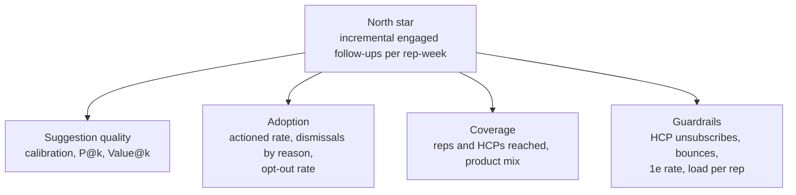

---

## 9. MLOps and the feedback loop

### 9.1 The loop

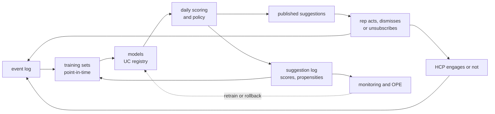

### 9.2 Lifecycle and promotion

- **Code and deployment:** Git repo and Databricks Asset Bundles (dev → test → prod). Workflows for the daily, weekly and
  monthly jobs (§4.4). Unity Catalog permissions on every table and model.
- **Models:** MLflow tracking; Unity Catalog registry with aliases `@champion` / `@challenger`. Scoring only ever loads
  `@champion`, and rollback means moving the alias back.
- **Reproducibility:** training sets record the Delta versions of their inputs. Feature definitions live in code, and
  seeds are fixed. Every suggestion records its model and prompt versions.
- **Retraining triggers:** monthly; feature drift (e.g. PSI > 0.2 on a top-10 feature); KPI degradation; or a new theme.
  Promotion follows the gates in §8.1.

### 9.3 Suggestion log (decision record)

| Column | Description |
|---|---|
| `suggestion_uid`, `decision_date`, `theme_id`, `theme_version` | identity |
| `employee_id`, `customer_id`, `product_id`, `trigger_event_id`, `trigger_age_days` | candidate |
| `p_act`, `p_engage`, `value_weight`, `ev`, `rank`, `slots` | scores and policy |
| `explored`, `propensity` | exploration (for OPE) |
| `model_versions` (map), `feature_snapshot_ref` | reproducibility |
| `constraint_trace` (array) | which constraints were evaluated and passed |
| `top_drivers` (array) | SHAP drivers sent to the LLM |
| `title`, `commentary`, `text_source` (`LLM` / `TEMPLATE`), `guardrail_status`, `prompt_id` | text |
| `published` | `false` in shadow mode |
| `veeva_suggestion_id` | joined back from `stg_suggestion_survey` (see O7) |

### 9.4 Monitoring

| Area | Metric | Alert example |
|---|---|---|
| Data freshness | max `event_date` per source vs expected | source lag > 1 day → skip publish, keep yesterday's suggestions |
| Feature drift | PSI per top feature; recomputed features vs `pd2` values for today | PSI > 0.2, or parity mismatch > 1 % |
| Prediction drift | distribution of `p_act`, `p_engage`, EV | mean shift > 3σ vs trailing 8 weeks |
| Outcomes | actioned / dismissed by reason, follow-up rate, engagement | dismissal rate up > 30 % relative |
| Volume | suggestions per rep-week, share explored | outside capacity bounds |
| Text | fallback rate by reason, length distribution | `UNGROUNDED_TOKEN` > 5 % |
| Adoption | opt-out rate (subscriptions) | weekly opt-outs > agreed threshold |

### 9.5 Diagnostics: "why did rep X get no suggestion?"

Every constraint writes its reason code to a funnel audit table. The team's *algo-suggestion-diagnostics* workflow
(stepwise count trails) then becomes a single query:

```sql
SELECT constraint_code, COUNT(*) AS candidates_removed
FROM nba_constraint_audit
WHERE decision_date = current_date() AND theme_id = 'POST_CALL_EMAIL' AND employee_id = :rep
GROUP BY constraint_code
ORDER BY candidates_removed DESC;
```

---

## 10. Roadmap, risks and open questions

### 10.1 Phased roadmap

| Phase | Scope | Exit criteria |
|---|---|---|
| **0. Foundations** | Event log. Product attribution for 1:M. Point-in-time feature tables. Generic label builder. **Start a daily snapshot of `pd2` now.** Evidence dashboard (Appendix A) | Labels reproduce E9–E12. Feature parity with `pd2` for today |
| **1. MVP offline and shadow** | `POST_CALL_EMAIL`: two heads plus CF features, policy, LLM reasons with guardrails, backtest vs B2, shadow mode | Gate 1 and Gate 2 (§8.1) |
| **2. Pilot** | Rep-randomised A/B. Exploration and propensity logging on. Read the opt-out subscription table. Switch off the post-call email rule family for treatment reps | Gate 3. Then roll out and retire the 26 replaced notebooks |
| **3. More themes** | `EMAIL_ENGAGEMENT_TO_REP`, `EVENT_FOLLOWUP`, `NO_RESPONSE_SWITCH`, `REENGAGE`. Alignment-based routing. Absence detector. Shared per-rep budget across themes | Each theme passes its own ladder |
| **4. Content personalisation** | "Which email": mined presentation → content mapping [E14] plus HCP × content CF and template availability. `EMAIL_TEMPLATE_ID_VOD__C` in `TAGS`. Later, a curated transaction → content mapping table | Lift vs rule-mapped templates. Fewer "2e" dismissals |
| **5. Advanced** | Uplift / noisy-OR $q(x)$, OPE-driven iteration, sequence models, multi-market rollout (`stg_suggestion_survey` already spans 44 markets [E6c]) | Per initiative |

### 10.2 Risks

| Risk | Impact | Mitigation |
|---|---|---|
| Leakage through snapshot tables or future-dated rows | inflated offline metrics, failed pilot | event-log features, as-of joins, `pd2` parity checks, strict `Submitted_vod` filters |
| Feedback loops / popularity bias | the model never learns beyond the status quo | exploration slots, propensity logging, OPE |
| Confounded labels | targeting the wrong HCPs | IPW, randomised pilot, uplift later |
| Notification fatigue under opt-out | opt-outs and dismissals rise, trust falls | capacity caps, auto-mute, guardrail KPIs, one suggestion per rep-HCP |
| LLM text compliance | regulatory exposure | facts-only payload, lexicon, grounding checks, template fallback, MLR approval, logging |
| Noisy engagement labels (machine opens, repeat opens) | biased head 2 | clicks plus opens after 60 s, unique-per-email labels |
| Hold-out not enforced | invalid control group | confirm O3, or create a fresh randomised control |
| Low rep trust or explainability | low adoption | SHAP-grounded reasons, visible mute controls, keep informational insights as rules |
| HR sensitivity of rep-level modelling | employee-relations concerns | rep embeddings for ranking only, no peer comparisons in text, aggregated reporting |
| Team change (from rules to ML) | slow adoption | rules remain for compliance and informational themes, funnel diagnostics, shared evaluation reports |

### 10.3 Open questions

| # | Question | Suggested owner |
|---|---|---|
| O1 | Who owns the value weight $v(h,p)$: RACE-based, potential-based, or product-priority based? | Commercial excellence |
| O2 | What is the per-rep capacity budget across themes (suggestions per week)? | Business / sales management |
| O3 | Which algorithms honour `it_comm_int_bus_cust_hold_out`? 1,360 hold-out HCPs received suggestions in 2026 [E15d] | NBA platform owner |
| O4 | What do `actioned` and `marked_as_complete` mean per record type in Veeva? Does `actioned` on Email_vod mean the email was sent? | Veeva CRM team |
| O5 | Which LLM endpoint is approved under GSK AI policy, and what is the MLR review process for prompts and few-shots? | AI governance, MLR |
| O6 | How is `DIM_ID` generated for a new algorithm, and how is a new algorithm UUID registered in the orchestrator? | NBA platform owner |
| O7 | Can `suggestion_external_id_vod__c` carry our `suggestion_uid`, for exact feedback joins? | Veeva CRM team |
| O8 | Are KAM eligible for `POST_CALL_EMAIL`? MSL are excluded as non-promotional | Business, compliance |
| O9 | Is there a source of approved 1:1 email templates per product (availability feature, Phase 4)? | Content / Veeva Vault team |
| O10 | When do calls and MCI land relative to the daily job (completeness of D−1), and which time zone do timestamps use? | Data engineering |

---

## Appendix A. Evidence SQL

All queries are read-only aggregates (no row-level or personal data) and were run on 2026-10-23. Run them after:

```text
USE CATALOG rx_g_digital_fuel_commercial_prod001;
USE SCHEMA nba_2_0;
```

Analysis windows are fixed (mostly 2025-09-01 → 2026-09-30), so re-running later reproduces the same numbers unless
source rows are restated. Queries without a window (volumes, coverage) will drift as data grows.

### E1 — Call table: rows and calls by status

*Used in: §2.1, §2.4 (#1).*

```sql
-- E1
SELECT call_status,
       COUNT(*)                AS row_cnt,
       COUNT(DISTINCT call_id) AS call_cnt,
       MIN(activity_date)      AS min_date,
       MAX(activity_date)      AS max_date
FROM it_stg_sf_call_actual_dedup
GROUP BY call_status
ORDER BY row_cnt DESC;
```

### E2 — Submitted calls: volume by employee type

*Used in: §2.1, §2.2.*

```sql
-- E2
SELECT CASE WHEN GROUPING(employee_type) = 1 THEN '_ALL_' ELSE COALESCE(employee_type, '(null)') END AS employee_type,
       COUNT(DISTINCT call_id)     AS calls,
       COUNT(DISTINCT employee_id) AS employees,
       COUNT(DISTINCT customer_id) AS hcps,
       COUNT(DISTINCT product_id)  AS products
FROM it_stg_sf_call_actual_dedup
WHERE call_status = 'Submitted_vod'
GROUP BY GROUPING SETS ((), (employee_type))
ORDER BY calls DESC;
```

### E3 — Submitted calls: channel mix

*Used in: §2.2, §2.4, §4.3, §6.6.*

```sql
-- E3
SELECT channel_name,
       COUNT(DISTINCT call_id) AS calls
FROM it_stg_sf_call_actual_dedup
WHERE call_status = 'Submitted_vod'
GROUP BY channel_name
ORDER BY calls DESC
LIMIT 8;
```

```sql
-- E3b  monthly volume (seasonality, §2.4 #7)
SELECT SUBSTR(activity_date, 1, 7)                       AS month,
       COUNT(DISTINCT call_id)                            AS calls,
       ROUND(COUNT(*) / COUNT(DISTINCT call_id), 2)       AS rows_per_call
FROM it_stg_sf_call_actual_dedup
WHERE call_status = 'Submitted_vod'
  AND activity_date BETWEEN '2026-05-01' AND '2026-09-30'
GROUP BY SUBSTR(activity_date, 1, 7)
ORDER BY month;
```

```sql
-- E3c  rows per call (grain, §2.2)
SELECT PERCENTILE_APPROX(n, ARRAY(0.5, 0.9, 0.99)) AS rows_per_call_p50_p90_p99
FROM (SELECT call_id, COUNT(*) AS n FROM it_stg_sf_call_actual_dedup WHERE call_status = 'Submitted_vod' GROUP BY call_id);
```

```sql
-- E3d  products detailed per Rep call (§6.6)
SELECT ROUND(AVG(n), 2) AS avg_products_per_call, PERCENTILE_APPROX(n, ARRAY(0.5, 0.9)) AS p50_p90
FROM (SELECT call_id, COUNT(DISTINCT product_id) AS n
      FROM it_stg_sf_call_actual_dedup
      WHERE call_status = 'Submitted_vod' AND employee_type = 'Rep'
        AND TO_DATE(activity_date) BETWEEN '2025-09-01' AND '2026-09-30'
      GROUP BY call_id);
```

```sql
-- E3e  call x product keys with more than one HCP or rep (event-key design, §2.4 #14)
SELECT SUM(CASE WHEN n_rows > 1 THEN 1 ELSE 0 END) AS dup_keys,
       SUM(CASE WHEN n_cust > 1 THEN 1 ELSE 0 END) AS multi_customer,
       SUM(CASE WHEN n_emp  > 1 THEN 1 ELSE 0 END) AS multi_employee
FROM (SELECT call_id, product_id, COUNT(DISTINCT customer_id) AS n_cust, COUNT(DISTINCT employee_id) AS n_emp,
             COUNT(*) AS n_rows
      FROM (SELECT DISTINCT call_id, customer_id, employee_id, product_id
            FROM it_stg_sf_call_actual_dedup
            WHERE call_status = 'Submitted_vod' AND activity_date <= '2026-10-23')
      GROUP BY call_id, product_id);
```

### E4 — MCI: overall volume, and channel × action mix with ID coverage

*Used in: §2.1, §2.2.*

```sql
-- E4a
SELECT COUNT(*)                    AS row_cnt,
       COUNT(DISTINCT CUSTOMER_ID) AS hcps,
       MIN(ACTIVITY_TIMESTAMP)     AS min_ts,
       MAX(ACTIVITY_TIMESTAMP)     AS max_ts
FROM it_stg_mci_dedup;
```

```sql
-- E4b
SELECT CHANNEL_NM,
       ACTION_NAME,
       COUNT(*)                    AS row_cnt,
       COUNT(DISTINCT CUSTOMER_ID) AS hcps,
       ROUND(AVG(CASE WHEN NULLIF(EMPLOYEE_ID, '') IS NOT NULL THEN 1 ELSE 0 END), 3) AS pct_with_employee,
       ROUND(AVG(CASE WHEN NULLIF(PRODUCT_ID, '')  IS NOT NULL THEN 1 ELSE 0 END), 3) AS pct_with_product
FROM it_stg_mci_dedup
GROUP BY CHANNEL_NM, ACTION_NAME
ORDER BY row_cnt DESC
LIMIT 12;
```

### E5 — 1:M email product attribution coverage

*Used in: §2.1, §2.4 (#3).*

```sql
-- E5
SELECT ROUND(AVG(CASE WHEN NULLIF(PRODUCT_ID, '') IS NOT NULL THEN 1 ELSE 0 END), 3)                  AS pct_product_id,
       ROUND(AVG(CASE WHEN NULLIF(ADOBE_CAMPAIGN_PRODUCT_NAME, '') IS NOT NULL THEN 1 ELSE 0 END), 3) AS pct_adobe_campaign_product
FROM it_stg_mci_dedup
WHERE CHANNEL_NM = '1:M Email-SFMC';
```

### E6 — Suggestion feedback (Italy): volume and outcome rates by record type

*Used in: §0, §2.1, §2.2, §8.5.*

```sql
-- E6a
SELECT COUNT(DISTINCT suggestion_id)  AS suggestions,
       COUNT(DISTINCT ownerid)        AS reps,
       COUNT(DISTINCT account_vod__c) AS hcps,
       MIN(posted_date_vod__c)        AS first_posted,
       MAX(posted_date_vod__c)        AS last_posted
FROM stg_suggestion_survey
WHERE loc_cd = 'IT';
```

```sql
-- E6b
WITH s AS (
  SELECT suggestion_id,
         MAX(record_type_name_vod__c)                  AS record_type,
         MAX(CAST(actioned_vod__c AS DOUBLE))           AS actioned,
         MAX(CAST(dismissed_vod__c AS DOUBLE))          AS dismissed,
         MAX(CAST(marked_as_complete_vod__c AS DOUBLE)) AS completed
  FROM stg_suggestion_survey
  WHERE loc_cd = 'IT'
  GROUP BY suggestion_id
)
SELECT record_type,
       COUNT(*)                              AS suggestions,
       ROUND(AVG(COALESCE(actioned, 0)), 3)  AS actioned_rate,
       ROUND(AVG(COALESCE(dismissed, 0)), 3) AS dismissed_rate,
       ROUND(AVG(COALESCE(completed, 0)), 3) AS completed_rate,
       ROUND(AVG(CASE WHEN COALESCE(actioned, 0) + COALESCE(dismissed, 0) + COALESCE(completed, 0) = 0
                      THEN 1 ELSE 0 END), 3) AS no_response_rate
FROM s
GROUP BY record_type
ORDER BY suggestions DESC;
```

```sql
-- E6c  markets present in the suggestion log (§10.1)
SELECT COUNT(DISTINCT loc_cd) AS markets FROM stg_suggestion_survey;
```

### E7 — Dismissal reasons actually selected by Italian reps

*Used in: §0, §1.5, §2.2.*

```sql
-- E7
SELECT survey_name,
       response_vod__c               AS reason,
       COUNT(DISTINCT suggestion_id) AS suggestions
FROM stg_suggestion_survey
WHERE loc_cd = 'IT'
  AND NULLIF(response_vod__c, '') IS NOT NULL
GROUP BY survey_name, response_vod__c
ORDER BY suggestions DESC
LIMIT 15;
```

### E8 — Current suggestion load per rep-week (Italy)

*Used in: §0, §2.2, §5.2.*

```sql
-- E8
WITH w AS (
  SELECT ownerid,
         DATE_TRUNC('week', TO_DATE(SUBSTR(posted_date_vod__c, 1, 10)))                         AS wk,
         COUNT(DISTINCT suggestion_id)                                                           AS all_sugg,
         COUNT(DISTINCT CASE WHEN record_type_name_vod__c = 'Email_vod' THEN suggestion_id END) AS email_sugg
  FROM stg_suggestion_survey
  WHERE loc_cd = 'IT'
  GROUP BY ownerid, DATE_TRUNC('week', TO_DATE(SUBSTR(posted_date_vod__c, 1, 10)))
)
SELECT PERCENTILE_APPROX(all_sugg, ARRAY(0.25, 0.5, 0.75, 0.9))                                    AS all_p25_p50_p75_p90,
       PERCENTILE_APPROX(CASE WHEN email_sugg > 0 THEN email_sugg END, ARRAY(0.25, 0.5, 0.75, 0.9)) AS email_p25_p50_p75_p90
FROM w;
```

### E9 — MVP evidence: call → same-rep 1:1 email follow-up rate, by channel and window

*Used in: §0, §2.3.*

```sql
-- E9
WITH calls AS (
  SELECT DISTINCT call_id, employee_id, customer_id, channel_name, TO_DATE(activity_date) AS call_date
  FROM it_stg_sf_call_actual_dedup
  WHERE call_status = 'Submitted_vod'
    AND employee_type = 'Rep'
    AND TO_DATE(activity_date) BETWEEN '2025-09-01' AND '2026-09-30'
),
emails AS (
  SELECT DISTINCT EMPLOYEE_ID AS employee_id, CUSTOMER_ID AS customer_id,
         TO_DATE(SUBSTR(ACTIVITY_TIMESTAMP, 1, 10)) AS email_date
  FROM it_stg_mci_dedup
  WHERE CHANNEL_NM = '1:1 Email' AND ACTION_NAME = 'Delivered_vod'
),
lag AS (
  SELECT c.call_id, c.employee_id, c.channel_name,
         MIN(DATEDIFF(e.email_date, c.call_date)) AS days_to_email
  FROM calls c
  LEFT JOIN emails e
    ON  e.employee_id = c.employee_id
    AND e.customer_id = c.customer_id
    AND e.email_date BETWEEN c.call_date AND DATE_ADD(c.call_date, 14)
  GROUP BY c.call_id, c.employee_id, c.channel_name
)
SELECT channel_name,
       COUNT(*)                                                         AS calls,
       ROUND(AVG(CASE WHEN days_to_email = 0  THEN 1 ELSE 0 END), 4) AS same_day,
       ROUND(AVG(CASE WHEN days_to_email <= 3  THEN 1 ELSE 0 END), 4) AS within_3d,
       ROUND(AVG(CASE WHEN days_to_email <= 7  THEN 1 ELSE 0 END), 4) AS within_7d,
       ROUND(AVG(CASE WHEN days_to_email <= 14 THEN 1 ELSE 0 END), 4) AS within_14d
FROM lag
GROUP BY channel_name
HAVING COUNT(*) >= 1000
ORDER BY calls DESC;
```

### E10 — Decay curve: days from F2F call to the first same-rep 1:1 email

*Used in: §0, §2.3, §6.2.*

```sql
-- E10
WITH calls AS (
  SELECT DISTINCT call_id, employee_id, customer_id, TO_DATE(activity_date) AS call_date
  FROM it_stg_sf_call_actual_dedup
  WHERE call_status = 'Submitted_vod' AND employee_type = 'Rep' AND channel_name = 'F2F'
    AND TO_DATE(activity_date) BETWEEN '2025-09-01' AND '2026-09-30'
),
emails AS (
  SELECT DISTINCT EMPLOYEE_ID AS employee_id, CUSTOMER_ID AS customer_id,
         TO_DATE(SUBSTR(ACTIVITY_TIMESTAMP, 1, 10)) AS email_date
  FROM it_stg_mci_dedup
  WHERE CHANNEL_NM = '1:1 Email' AND ACTION_NAME = 'Delivered_vod'
),
lag AS (
  SELECT c.call_id, MIN(DATEDIFF(e.email_date, c.call_date)) AS days_to_email
  FROM calls c
  LEFT JOIN emails e
    ON  e.employee_id = c.employee_id
    AND e.customer_id = c.customer_id
    AND e.email_date BETWEEN c.call_date AND DATE_ADD(c.call_date, 14)
  GROUP BY c.call_id
)
SELECT days_to_email,                              -- NULL = no email within 14 days
       COUNT(*)                                     AS calls,
       ROUND(COUNT(*) / SUM(COUNT(*)) OVER (), 4)   AS share_of_f2f_calls
FROM lag
GROUP BY days_to_email
ORDER BY days_to_email NULLS LAST;
```

### E11 — Collaborative signal: per-rep 7-day follow-up rate (reps with ≥ 100 F2F calls)

*Used in: §0, §2.3, §8.5.*

```sql
-- E11
WITH calls AS (
  SELECT DISTINCT call_id, employee_id, customer_id, TO_DATE(activity_date) AS call_date
  FROM it_stg_sf_call_actual_dedup
  WHERE call_status = 'Submitted_vod' AND employee_type = 'Rep' AND channel_name = 'F2F'
    AND TO_DATE(activity_date) BETWEEN '2025-09-01' AND '2026-09-30'
),
emails AS (
  SELECT DISTINCT EMPLOYEE_ID AS employee_id, CUSTOMER_ID AS customer_id,
         TO_DATE(SUBSTR(ACTIVITY_TIMESTAMP, 1, 10)) AS email_date
  FROM it_stg_mci_dedup
  WHERE CHANNEL_NM = '1:1 Email' AND ACTION_NAME = 'Delivered_vod'
),
per_call AS (
  SELECT c.call_id, c.employee_id,
         MAX(CASE WHEN e.email_date IS NOT NULL THEN 1 ELSE 0 END) AS followed_up_7d
  FROM calls c
  LEFT JOIN emails e
    ON  e.employee_id = c.employee_id
    AND e.customer_id = c.customer_id
    AND e.email_date BETWEEN c.call_date AND DATE_ADD(c.call_date, 7)
  GROUP BY c.call_id, c.employee_id
),
per_rep AS (
  SELECT employee_id, COUNT(*) AS f2f_calls, AVG(followed_up_7d) AS rate_7d
  FROM per_call
  GROUP BY employee_id
  HAVING COUNT(*) >= 100
)
SELECT COUNT(*)                                                     AS reps,
       PERCENTILE_APPROX(rate_7d, ARRAY(0.1, 0.25, 0.5, 0.75, 0.9)) AS p10_p25_p50_p75_p90,
       ROUND(AVG(CASE WHEN rate_7d = 0 THEN 1 ELSE 0 END), 3)       AS share_never_follow_up
FROM per_rep;
```

### E12 — Engagement label quality: 1:1 email opens/clicks within 14 days (post-call vs other emails)

*Used in: §0, §2.3, §3.6, §6.2.*

```sql
-- E12
WITH ev AS (
  SELECT DISTINCT EMPLOYEE_ID AS employee_id, CUSTOMER_ID AS customer_id, CONTENT_ID AS content_id,
         ACTION_NAME AS action, TO_TIMESTAMP(ACTIVITY_TIMESTAMP) AS ts
  FROM it_stg_mci_dedup
  WHERE CHANNEL_NM = '1:1 Email'
    AND TO_DATE(SUBSTR(ACTIVITY_TIMESTAMP, 1, 10)) BETWEEN '2025-09-01' AND '2026-09-30'
),
delivered AS (
  SELECT DISTINCT employee_id, customer_id, content_id, ts FROM ev WHERE action = 'Delivered_vod'
),
lab AS (
  SELECT d.employee_id, d.customer_id, d.content_id, d.ts,
         MAX(CASE WHEN e.action = 'Opened_vod' THEN 1 ELSE 0 END)                                         AS open_14d,
         MAX(CASE WHEN e.action = 'Opened_vod' AND e.ts <= d.ts + INTERVAL 1 MINUTE THEN 1 ELSE 0 END)  AS open_within_60s,
         MAX(CASE WHEN e.action = 'Opened_vod' AND e.ts >  d.ts + INTERVAL 1 MINUTE THEN 1 ELSE 0 END)  AS open_after_60s,
         MAX(CASE WHEN e.action = 'Clicked_vod' THEN 1 ELSE 0 END)                                        AS click_14d
  FROM delivered d
  LEFT JOIN ev e
    ON  e.employee_id = d.employee_id
    AND e.customer_id = d.customer_id
    AND e.content_id  = d.content_id
    AND e.action IN ('Opened_vod', 'Clicked_vod')
    AND e.ts BETWEEN d.ts AND d.ts + INTERVAL 14 DAYS
  GROUP BY d.employee_id, d.customer_id, d.content_id, d.ts
),
rep_calls AS (
  SELECT DISTINCT employee_id, customer_id, TO_DATE(activity_date) AS call_date
  FROM it_stg_sf_call_actual_dedup
  WHERE call_status = 'Submitted_vod' AND employee_type = 'Rep'
),
post_call AS (
  SELECT DISTINCT d.employee_id, d.customer_id, d.content_id, d.ts
  FROM delivered d
  JOIN rep_calls c
    ON  c.employee_id = d.employee_id
    AND c.customer_id = d.customer_id
    AND c.call_date BETWEEN DATE_SUB(TO_DATE(d.ts), 7) AND TO_DATE(d.ts)
),
g AS (
  SELECT l.*, CASE WHEN p.employee_id IS NOT NULL THEN 'post_call_7d' ELSE 'other' END AS grp
  FROM lab l
  LEFT JOIN post_call p
    ON  p.employee_id = l.employee_id AND p.customer_id = l.customer_id
    AND p.content_id  = l.content_id  AND p.ts = l.ts
)
SELECT COALESCE(grp, '_ALL_')           AS grp,
       COUNT(*)                         AS delivered,
       ROUND(AVG(open_14d), 3)          AS open_14d,
       ROUND(AVG(open_within_60s), 3)   AS open_within_60s,
       ROUND(AVG(open_after_60s), 3)    AS open_after_60s,
       ROUND(AVG(click_14d), 4)         AS click_14d
FROM g
GROUP BY ROLLUP(grp)
ORDER BY grp;
```

### E13 — Digital → rep: does HCP digital engagement change rep behaviour today?

*Used in: §0, §2.3.*

```sql
-- E13
WITH dig AS (
  SELECT DISTINCT CUSTOMER_ID AS customer_id, CHANNEL_NM AS channel, ACTION_NAME AS action,
         TO_DATE(SUBSTR(ACTIVITY_TIMESTAMP, 1, 10)) AS event_date
  FROM it_stg_mci_dedup
  WHERE ACTION_NAME IN ('Email_Delivered', 'Email_Opened', 'Email_Clicked', 'Opened_vod', 'Clicked_vod',
                        'Attended_vod', 'Registrant', 'Attended')
    AND TO_DATE(SUBSTR(ACTIVITY_TIMESTAMP, 1, 10)) BETWEEN '2025-09-01' AND '2026-09-30'
),
rep_calls AS (
  SELECT DISTINCT customer_id, TO_DATE(activity_date) AS call_date
  FROM it_stg_sf_call_actual_dedup
  WHERE call_status = 'Submitted_vod' AND employee_type = 'Rep'
),
nxt AS (
  SELECT d.customer_id, d.channel, d.action, d.event_date,
         MIN(DATEDIFF(c.call_date, d.event_date)) AS days_to_call
  FROM dig d
  LEFT JOIN rep_calls c
    ON  c.customer_id = d.customer_id
    AND c.call_date BETWEEN d.event_date AND DATE_ADD(d.event_date, 14)
  GROUP BY d.customer_id, d.channel, d.action, d.event_date
)
SELECT channel, action,
       COUNT(*)                                                      AS hcp_days,
       ROUND(AVG(CASE WHEN days_to_call <= 7  THEN 1 ELSE 0 END), 3) AS rep_call_within_7d,
       ROUND(AVG(CASE WHEN days_to_call <= 14 THEN 1 ELSE 0 END), 3) AS rep_call_within_14d
FROM nxt
GROUP BY channel, action
ORDER BY hcp_days DESC;
```

### E14 — Phase-4 content mapping: presentation shown → content of the follow-up email

*Used in: §2.3, §10.1.*

```sql
-- E14a
WITH pres_calls AS (
  SELECT DISTINCT call_id, employee_id, customer_id, TO_DATE(activity_date) AS call_date, presentation_name
  FROM it_stg_sf_call_actual_dedup
  WHERE call_status = 'Submitted_vod' AND channel_name = 'F2F' AND presentation_name IS NOT NULL
    AND TO_DATE(activity_date) BETWEEN '2025-09-01' AND '2026-09-30'
),
emails AS (
  SELECT DISTINCT EMPLOYEE_ID AS employee_id, CUSTOMER_ID AS customer_id,
         TO_DATE(SUBSTR(ACTIVITY_TIMESTAMP, 1, 10)) AS email_date, CONTENT_ID AS content_id
  FROM it_stg_mci_dedup
  WHERE CHANNEL_NM = '1:1 Email' AND ACTION_NAME = 'Delivered_vod'
),
pairs AS (
  SELECT p.presentation_name, e.content_id, COUNT(DISTINCT p.call_id) AS n
  FROM pres_calls p
  JOIN emails e
    ON  e.employee_id = p.employee_id
    AND e.customer_id = p.customer_id
    AND e.email_date BETWEEN p.call_date AND DATE_ADD(p.call_date, 7)
  GROUP BY p.presentation_name, e.content_id
),
per_pres AS (
  SELECT presentation_name, SUM(n) AS pairs, MAX(n) AS top1, COUNT(*) AS contents
  FROM pairs
  GROUP BY presentation_name
)
SELECT COUNT(*)                                       AS presentations,
       SUM(pairs)                                     AS call_content_pairs,
       ROUND(SUM(top1) / SUM(pairs), 3)               AS top1_content_share,
       PERCENTILE_APPROX(contents, ARRAY(0.5, 0.9))   AS contents_per_presentation_p50_p90
FROM per_pres;
```

```sql
-- E14b (same CTEs as E14a, different final SELECT)
WITH pres_calls AS (
  SELECT DISTINCT call_id, employee_id, customer_id, TO_DATE(activity_date) AS call_date, presentation_name
  FROM it_stg_sf_call_actual_dedup
  WHERE call_status = 'Submitted_vod' AND channel_name = 'F2F' AND presentation_name IS NOT NULL
    AND TO_DATE(activity_date) BETWEEN '2025-09-01' AND '2026-09-30'
),
emails AS (
  SELECT DISTINCT EMPLOYEE_ID AS employee_id, CUSTOMER_ID AS customer_id,
         TO_DATE(SUBSTR(ACTIVITY_TIMESTAMP, 1, 10)) AS email_date, CONTENT_ID AS content_id
  FROM it_stg_mci_dedup
  WHERE CHANNEL_NM = '1:1 Email' AND ACTION_NAME = 'Delivered_vod'
),
pairs AS (
  SELECT p.presentation_name, e.content_id, COUNT(DISTINCT p.call_id) AS n
  FROM pres_calls p
  JOIN emails e
    ON  e.employee_id = p.employee_id
    AND e.customer_id = p.customer_id
    AND e.email_date BETWEEN p.call_date AND DATE_ADD(p.call_date, 7)
  GROUP BY p.presentation_name, e.content_id
)
SELECT presentation_name,
       SUM(n)                         AS pairs,
       ROUND(MAX(n) / SUM(n), 3)      AS top1_content_share,
       COUNT(*)                       AS contents
FROM pairs
GROUP BY presentation_name
ORDER BY pairs DESC
LIMIT 5;
```

### E15 — Supporting assets: consent, multi-rep HCPs, alignment, routing, hold-out, snapshot history

*Used in: §2.1, §2.4, §5.3.*

```sql
-- E15a  email consent coverage
SELECT channel_id, has_consent, COUNT(DISTINCT customer_id) AS hcps
FROM stg_consent
WHERE loc_cd = 'IT'
GROUP BY channel_id, has_consent
ORDER BY hcps DESC
LIMIT 6;
```

```sql
-- E15b  reps calling the same HCP (6-month window)
SELECT PERCENTILE_APPROX(n, ARRAY(0.5, 0.9, 0.99))         AS p50_p90_p99,
       MAX(n)                                              AS max_reps,
       ROUND(AVG(CASE WHEN n > 1 THEN 1 ELSE 0 END), 3)    AS share_multi_rep
FROM (
  SELECT customer_id, COUNT(DISTINCT employee_id) AS n
  FROM it_stg_sf_call_actual_dedup
  WHERE call_status = 'Submitted_vod' AND employee_type = 'Rep'
    AND TO_DATE(activity_date) BETWEEN '2026-04-01' AND '2026-09-30'
  GROUP BY customer_id
);
```

```sql
-- E15c  routing sources: owner table by country, and Italian territory alignment
SELECT 'stg_emp_hcp_owner' AS source, loc_cd, COUNT(*) AS row_cnt, COUNT(DISTINCT customer_id) AS hcps
FROM stg_emp_hcp_owner GROUP BY loc_cd
UNION ALL
SELECT 'stg_alignment', loc_cd, COUNT(*), COUNT(DISTINCT customer_id)
FROM stg_alignment WHERE loc_cd = 'IT' GROUP BY loc_cd;
```

```sql
-- E15d  hold-out HCPs that still received calls / suggestions (2026-01-01 .. 2026-09-30)
SELECT COUNT(DISTINCT h.bus_customer_code)                                                    AS holdout_hcps,
       COUNT(DISTINCT CASE WHEN c.customer_id IS NOT NULL THEN h.bus_customer_code END)       AS with_rep_calls,
       COUNT(DISTINCT CASE WHEN s.account_vod__c IS NOT NULL THEN h.bus_customer_code END)    AS with_suggestions
FROM it_comm_int_bus_cust_hold_out h
LEFT JOIN (SELECT DISTINCT customer_id FROM it_stg_sf_call_actual_dedup
           WHERE call_status = 'Submitted_vod' AND TO_DATE(activity_date) BETWEEN '2026-01-01' AND '2026-09-30') c
       ON c.customer_id = h.bus_customer_code
LEFT JOIN (SELECT DISTINCT account_vod__c FROM stg_suggestion_survey
           WHERE loc_cd = 'IT' AND TO_DATE(SUBSTR(posted_date_vod__c, 1, 10)) BETWEEN '2026-01-01' AND '2026-09-30') s
       ON s.account_vod__c = h.bus_customer_code;
```

```sql
-- E15e  the pd2 metric tables are overwritten daily (current-state snapshot, one row per DIM_ID)
DESCRIBE HISTORY it_comm_con_pd2_call LIMIT 3;
```

---

## Appendix B. Glossary

| Term | Meaning |
|---|---|
| NBA | Next Best Action: a suggestion to a rep about what to do next for a customer |
| HCP / OS | Healthcare professional (Italian: *Operatore Sanitario*) |
| Rep / KAM / MSL | Sales representative / Key Account Manager / Medical Science Liaison (non-promotional) |
| RACE | Customer-journey segmentation: Reach, Acquisition, Conversion, Engagement |
| CLM / eDetail | Closed-loop marketing: a digital presentation (slides, key messages) shown during a call |
| 1:1 email (VAE) | Rep-sent Veeva Approved Email (MCI channel `1:1 Email`) |
| 1:M email (SFMC) | Mass email sent from Salesforce Marketing Cloud, without a rep |
| MCI | Multichannel interactions table (`it_stg_mci_dedup`) |
| Veeva Suggestion | CRM object that shows an NBA to the rep. Record types `Email_vod`, `Call_vod`, `Insight_vod` |
| Lifespan | Number of days a suggestion stays live in Veeva |
| Dismissal reasons 1e–5e | The rep's survey answer when dismissing an email suggestion (§2.2) |
| `pd2` tables | `it_comm_con_pd2_*`: current-state metric snapshots used by the rule engine |
| Trigger | An event that creates a candidate, e.g. a submitted call |
| Candidate | (rep, HCP, product, theme, trigger) that could be suggested on a decision day |
| Theme | Declarative definition of a kind of suggestion (§5) |
| EV | Expected value: $P(\text{act}) \times P(\text{engage} \mid \text{act}) \times v$ |
| Implicit ALS | Alternating-least-squares matrix factorisation for implicit feedback (§3.2) |
| GBDT | Gradient-boosted decision trees (LightGBM, XGBoost) |
| SHAP | Shapley additive explanations: per-feature contributions to one prediction |
| Calibration / ECE | Agreement between predicted probabilities and observed frequencies / expected calibration error |
| Point-in-time (as-of) join | Joining features using only data available at the decision time |
| Propensity | Probability with which the logging policy published a suggestion |
| OPE, IPS, SNIPS, DR | Off-policy evaluation and its estimators: inverse propensity scoring, self-normalised IPS, doubly robust |
| Uplift / incrementality | Causal effect of showing the suggestion on the outcome |
| CUPED | Variance reduction in experiments using pre-period covariates |
| ICC / design effect | Intra-cluster correlation / variance inflation from cluster randomisation |
| PSI | Population stability index, a drift metric |
| Champion / challenger | Production model alias vs candidate model alias in the Unity Catalog registry |
| MLR | Medical, Legal and Regulatory review |
| DNC | Do not contact |

