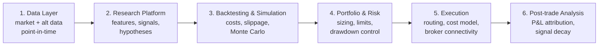

### hypothesis to test

1. opt position to take for nifty range at expiry (M, Q, Y)
2. long terms stock positioning

 ### req
 
 #### data req

                    EXTERNAL / INTERNAL SOURCES
                              │
          ┌───────────────────┼────────────────────┐
          │                   │                    │
     Market data          Fundamentals        Alternative data
     prices/trades        financials           text / satellite /
     order books          estimates             web / transactions
          │                   │                    │
          └───────────────────┼────────────────────┘
 
 

### HL components

##### Architecture

##### 1. data Layer
Bloomberg / Refinitiv / CRSP / Compustat / FRED / alternative data / adhoc docs

 ohlc (global & local) - yfinance 
 news/ sentiment - web scraping 
 events - ?? 
 macro economics - ?? 
 fii/dii - nse
 crude oil - 
 commodity pricing - 

##### 2. QR Layer
Stats/ DL/ ML
Factor model / alpha model / volatility model / portfolio optimizer

##### 3. backtest Layer
- Scenario engine, causal relationships, feedback loops, parameter uncertainty, external shocks,scenario clustering, sensitivity analysis
- ** Monte Carlo simulation **

##### 4. risk layer
Expected return, Volatility, VaR, Expected Shortfall, Drawdown, Scenario probabilities, Tail exposure, Key risk drivers

##### 5. execution layer
- NL based output
- trade trigger zerodha apis

##### 6. retrospective layer
- Reconciliation, P&L attribution and signal decay tracking. It shows whether live results match backtests and feeds back into research.

##### 7. 
