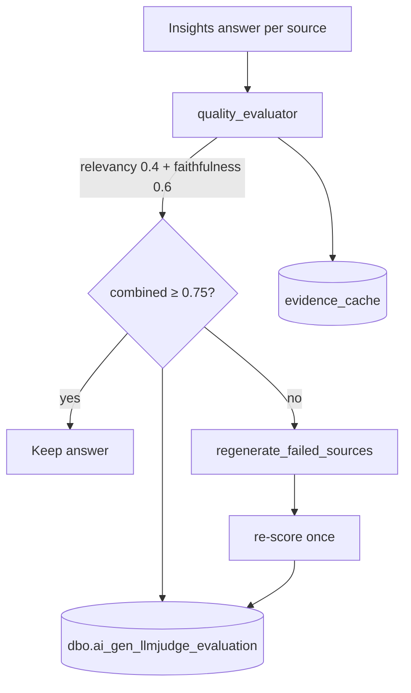

# 05 · Evaluation Framework

## Overview

Patient+ has a **genuine LLM-as-judge evaluation framework**, implemented as the **reflection
subsystem**. It is an **online / runtime** evaluator (it runs inside the request path), not an
offline benchmark harness. It scores each answer for **relevancy** and **faithfulness**, regenerates
answers that fall below threshold, and persists judge scores to a database. A second, independent
self-evaluation gate lives inside the analytics pipeline.

There is **no offline golden-dataset benchmark** (no RAGAS/DeepEval, no labelled regression set).
Functional tests exist but are run manually.

## Core LLM-as-judge framework — `apps/agents/reflection/`

### The scorers

[apps/agents/reflection/quality_evaluator.py](../apps/agents/reflection/quality_evaluator.py):

- `evaluate_relevancy_with_runtime` and `evaluate_faithfulness_with_runtime`.
- `EvalScoreResult` dataclass with `score`, `reason`, `details`, `fallback_used`, and a `passed`
  property (`score >= 0.75`).
- Weights: `_INTENT_WEIGHT = 0.6`, `_CONCISENESS_WEIGHT = 0.4`; `_FAITHFULNESS_THRESHOLD = 0.8`.
- Judge prompts load from
  [prompts/reflection/self_reflection_agent_prompts_v2.yaml](../prompts/reflection/self_reflection_agent_prompts_v2.yaml).
- Batching budgets: `_MAX_BATCHES = 10`, `_TOKENS_PER_BATCH = 30_000`.

### Combined scoring & regeneration trigger

[apps/agents/reflection/relevancy_evaluation.py](../apps/agents/reflection/relevancy_evaluation.py):

- `run_answer_relevancy_reflection_agent`: combined score = `RELEVANCY_WEIGHT 0.4 +
  FAITHFULNESS_WEIGHT 0.6`, `COMBINED_THRESHOLD = 0.75`, sets `needs_regeneration` per source.
- Evaluates against **cached evidence chunks** (via `evidence_cache.py`), not raw DB — so
  faithfulness is measured against exactly what the agent saw.

### Lifecycle & regeneration

- [apps/agents/reflection/orchestrator.py](../apps/agents/reflection/orchestrator.py):
  `run_reflection_agent` — evaluate → regenerate-below-threshold → cache cleanup. Wired into the
  graph as the `reflection` node after `insights_react`.
- [apps/agents/reflection/regeneration.py](../apps/agents/reflection/regeneration.py):
  `regenerate_failed_sources` — evidence-bound re-generation + re-scoring. Single-pass ("no
  recursion"); `_MAX_REGEN_ATTEMPTS = 2`, `_REGEN_BATCH_TOKEN_LIMIT = 25_000`; non-blocking.
- [apps/agents/reflection/evidence_cache.py](../apps/agents/reflection/evidence_cache.py):
  `read_evidence` / `delete_evidence` — the grounding store for faithfulness checks (written by
  `insights_tool`).

### Persistence of judge scores

[apps/agents/reflection/eval_db_writer.py](../apps/agents/reflection/eval_db_writer.py) writes to
table `dbo.ai_gen_llmjudge_evaluation`, one row per `conversationID`, storing `faithfulness_score`,
`relevancy_score`, `relevancy_gaps`, `faithfulness_gaps`, `overall_score`, `passed`, plus both the
`evaluated_answer` and the `regenerated_answer`. Feature-flagged via `ENABLE_LLMJUDGE_DB_PERSISTENCE`
(default on), non-blocking.

## Analytics self-evaluation gate

[apps/agents/analytics/reflector.py](../apps/agents/analytics/reflector.py) `reflect_source` is a
second, independent quality gate for the analytical pipeline — checking faithfulness of numbers,
answerability, small-sample caveats, hollow results, and circular analysis, returning a structured
`pass`/`revise` verdict. See [02 · Loop Engineering](02-loop-engineering.md) for its loop control.

## Functional tests & payloads (not output-quality eval)

- **Unit tests (pytest):** [patientplus_search/tests/](../patientplus_search/tests) —
  `test_filter_builder.py`, `test_postprocessing.py`, `test_registry.py`.
- **MCP tests:** [mcp/mcp-patientplus/](../mcp/mcp-patientplus) — `test_tools.py`,
  `test_best_practices.py`, etc. (+ `run_tests.ps1`).
- **E2E / manual scripts:** [Test_Results/E2E_testing/](../Test_Results/E2E_testing) —
  `test_all_phases.py` (a hand-rolled tiered runner, Phase 0–4; **not** pytest-based),
  `smoke_test_phase3.py`, `test_retrieval_direct.py`.
- **Test payloads:** [test_request.json](../test_request.json),
  [test_response_formatter_payloads.json](../test_response_formatter_payloads.json).
- **Manual procedures:** [docs/TESTING_GUIDE.md](../docs/TESTING_GUIDE.md),
  [docs/MANUAL_TESTING_CHECKLIST.md](../docs/MANUAL_TESTING_CHECKLIST.md).

## What does NOT exist

- **No offline eval harness with golden/reference datasets** — no labelled test set, no regression
  scoring against expected answers, no RAGAS/DeepEval integration.
- **No automated CI test execution** (see [03 · Repo-Help](03-repo-help-engineering.md)).

Output quality is measured entirely by: (1) faithfulness (grounded in retrieved evidence, threshold
0.8), (2) relevancy (intent 0.6 + conciseness 0.4), (3) combined threshold 0.75 → triggers
regeneration, and (4) the analytics reflector's structured verdict — with results logged to
`dbo.ai_gen_llmjudge_evaluation`.

---

## Room for Improvements

- **Add an offline evaluation harness with a golden dataset.** The DB already accumulates
  `(question, answer, scores)` rows — curate a labelled regression set from them and score new
  builds against it in CI. This catches regressions the online judge can't (it only sees the
  current answer, never "was this better last week?").
- **Adopt a standard eval library (RAGAS / DeepEval).** The custom relevancy/faithfulness scorers
  are solid, but RAGAS adds context-precision/recall and answer-correctness metrics with community
  validation, and DeepEval integrates with pytest for gated CI eval.
- **Guard against LLM-judge bias.** Relevancy and faithfulness are scored by the same model family
  producing the answers. Cross-model judging (e.g. Claude judges Gemini answers) or a small
  human-labelled calibration set would reduce self-preference bias.
- **Track eval metrics over time.** `dbo.ai_gen_llmjudge_evaluation` is a goldmine — build a
  dashboard (pass-rate, mean faithfulness, regeneration rate per source) to spot drift and quantify
  the ROI of prompt changes.
- **Evaluate the web/market-research paths too.** Reflection runs after `insights_react` only;
  Gemini web answers and Glean market-research answers bypass the judge. Extending faithfulness/
  citation-grounding checks to them would close a coverage gap.

## Quiz

**Q1. Why an online (runtime) judge instead of an offline benchmark?**
It provides **self-healing in production** — a low-scoring answer is regenerated before the user
sees it, which an offline harness can't do. It also needs no labelled dataset to start. *Alternative:*
offline golden-set scoring. *Could differ:* offline eval catches regressions and enables A/B prompt
comparison, so the ideal is *both* — online for self-healing, offline for regression gating.

**Q2. Why weight faithfulness (0.6) higher than relevancy (0.4)?**
In pharma analytics, a fluent-but-ungrounded (hallucinated) answer is far more dangerous than a
slightly off-topic one. Faithfulness = "is every claim backed by retrieved evidence," so it carries
more weight. *Alternative:* equal weights. *Could differ:* tune weights per source type — e.g.
weight relevancy higher for open-ended summarisation.

**Q3. Why evaluate faithfulness against the evidence cache instead of the raw database?**
Faithfulness must ask "did the answer stay true to *what the agent actually retrieved*," not to the
entire corpus. The evidence cache stores exactly the chunks the agent saw, so the judge and the
answer share the same ground truth. *Alternative:* re-retrieve for the judge. *Could differ:*
re-retrieval could detect retrieval gaps but would conflate retrieval quality with answer
faithfulness.

**Q4. Why is regeneration single-pass and non-blocking?**
Re-answering against the same fixed evidence rarely improves on a second attempt, so recursion buys
little; and a failed regeneration must never delete a usable original answer or stall the stream.
*Alternative:* looped regeneration / hard-fail on low score. *Could differ:* allow a 2nd pass only
when eval data shows it materially lifts pass-rate.

**Q5. Why persist judge scores to a DB with a feature flag?**
Persisted scores enable trend analysis, prompt-change ROI measurement, and future golden-set
curation — while the `ENABLE_LLMJUDGE_DB_PERSISTENCE` flag lets ops disable the extra write under
load or in environments without the table. *Alternative:* log-only. *Could differ:* a metrics
pipeline could aggregate scores without storing full answer text (PII/size considerations).

**Q6. Why have two separate evaluators (reflection + analytics reflector)?**
They evaluate fundamentally different artefacts: the reflection subsystem judges **free-text RAG
answers** (relevancy/faithfulness against evidence), while the analytics reflector audits
**computed results and their narration** (correct numbers, no circular analysis, sample-size
caveats). One judge can't do both well. *Alternative:* a unified evaluator. *Could differ:* share a
common `EvalScoreResult` contract and dashboard while keeping the domain-specific checks separate.
