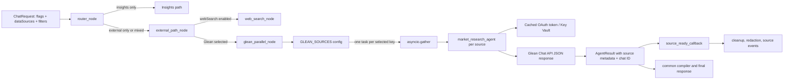

# Glean Universal Routing in Patient Plus

## 1. Theoretical Foundations

### Problem and model

The universal-routing design replaces source-specific graph branches with a configuration-driven fan-out. A Glean source is represented by a key, a user-facing display name, and optional API inclusion rules:

$$
C: source\_key \mapsto (display\_name, inclusions)
$$

At request time, routing identifies the requested logical sources, selects matching entries from $C$, calls each selected source independently, and merges the resulting `AgentResult` records into the common compiler input. This is orchestration and integration logic, not model training: there are no learned parameters, loss function, embeddings, or tensor dimensions in the universal-routing feature.

For $k$ selected Glean sources executed concurrently, and assuming enough provider/network capacity, all-source completion is approximately determined by the slowest source:

$$
T_{all} \approx \max_{i=1,\ldots,k} T_i
$$

The earliest independently streamable source arrives around $\min_i T_i$, plus local cleanup/redaction and transport overhead. Parallelism improves latency only when source calls are actually independent and provider limits, event-loop capacity, and downstream concurrency do not serialize them.

### Architectural breakdown



The current request path is:

1. `router_node()` separates canonical Glean sources from other data sources and chooses `insights_path`, `external_path`, or `mixed_path`.
2. `external_path_node()` concurrently runs web search and/or `glean_parallel_node()`.
3. `glean_parallel_node()` filters the configured source map to requested keys/display names and starts one `market_research_agent()` call per selected source with `asyncio.gather(..., return_exceptions=True)`.
4. Each agent builds a Glean Chat payload, obtains an OAuth token, calls the Glean endpoint, parses the answer and `chatId`, and returns source-labelled results.
5. Successful source results invoke `source_ready_callback` independently. They are cleaned and sent through the application streaming/redaction path; Glean itself is called as a JSON request here, not as a token stream.
6. The graph merges all `AgentResult` values for final compilation and memory persistence.

### Intended design versus current code

The supplied [GLEAN_UNIVERSAL_ROUTING.md](../docs/GLEAN_UNIVERSAL_ROUTING.md) and [GLEAN_UNIVERSAL_ROUTING.html](../docs/GLEAN_UNIVERSAL_ROUTING.html) describe the goal: replace many source-combination routes with a shared external path and add sources through `GLEAN_SOURCES_JSON`. The current tree does have the shared path and parallel node, but several details mean “add any source with only an environment change” is not universally true:

- `DataSource.glean_sources()` currently returns the fixed enum set `{Market Research, PED}`. `router_node()` and `external_path_node()` use this set to decide whether a request is Glean-backed. A newly configured display name outside that set may not activate the Glean path by itself.
- `glean_parallel_node()` matches requested `dataSources` against configured keys/display names, but it does not add `market_research` to `requested_keys` when only `request.marketResearch` is true. A flag-only request can therefore enter the external path and then find no configured Glean source.
- `GLEAN_SOURCES_JSON` supports legacy string values, but an arbitrary string-key source has no automatically generated inclusion filter. For non-`market_research` keys, `_build_glean_chat_payload()` only applies the source boundary when `inclusions` is provided. Configure inclusion rules explicitly to avoid querying outside the intended datasource/container.
- Conversation memory writes chat IDs by configured display name, while `_get_prior_glean_chat_id()` currently looks up only the Market Research key. This does not provide independent session continuity for every configured source and may pass the Market Research session to another Glean source.

Treat the docs as the intended architecture and configuration guide; verify a candidate source key, display-name registration, inclusion scope, request selection, and follow-up-session behavior against the current implementation before rollout.

### Trade-offs and alternatives

| Approach | Benefits | Costs / failure modes |
|---|---|---|
| Fixed graph node per source/combination | Explicit wiring and easy source-specific behavior | Route/node growth, duplicated code, every addition requires code changes |
| Configured source registry plus parallel fan-out (current direction) | Common agent/compiler contract; independent source execution and failure handling; less graph duplication | Configuration correctness becomes critical; source-selection and identity mappings must stay aligned |
| Sequential calls through one generic agent | Lower concurrency and simpler rate-limit control | Latency approaches the sum of source times; one slow source delays all later sources |
| External workflow/service bus per datasource | Strong isolation, independent scaling and retries | More deployment, tracing, idempotency, and operational complexity |

The registry pattern is a good fit while sources share authentication, payload, response, and memory semantics. Sources with materially different APIs or authorization rules may need a provider adapter rather than additional conditionals inside one generic agent.

## 2. Practical and Engineering Implementation

### Configuration and routing

`config.constants.GLEAN_SOURCES()` reads `GLEAN_SOURCES_JSON` lazily. It accepts a non-empty JSON object. Dictionary values are interpreted as source settings and can supply `inclusions`; their display names are resolved from the datasource mapping. Non-dictionary values are treated as legacy display-name strings. Invalid or empty configuration logs an error and falls back to the default Market Research and PED definitions.

The canonical `DataSource` registry classifies Market Research and PED as Glean-backed. `router_node()` derives `expected_sources` for streaming and chooses one of three logical routes. `external_path_node()` is responsible for executing web and Glean work concurrently and converting a node-level Glean exception into one error `AgentResult` per configured source.

The config shapes supported by the current parser are:

```json
{
	"market_research": {
		"inclusions": {
			"datasourceInstances": ["primarymarketresearch"]
		}
	},
	"ped": {
		"inclusions": {
			"containerSpecs": [
				{"url": "https://example.invalid/approved-container"}
			]
		}
	}
}
```

Legacy string mapping is still parsed, but it should not be assumed to scope arbitrary custom sources safely:

```json
{"market_research": "Market Research"}
```

### Code walkthrough

**Source registry.** `constants.GLEAN_SOURCES()` parses the environment setting, maps keys to display names, and returns inclusion payloads. The defaults are not a strict empty registry: Market Research and PED are returned when the setting is missing or invalid.

**External fan-out.** `orchestrator_workflow.glean_parallel_node()` selects configured keys based on requested data source key or display name, then invokes the same `market_research_agent()` for every selected entry. Each call receives `glean_source_id`, `display_name`, and `glean_inclusions`.

**Payload and API.** `market_research_agent._build_glean_chat_payload()` places the augmented query in a user message, sets Glean request options, adds optional inclusion rules, time-period facet filters, and a prior chat ID. `_call_glean_chat_api()` gets a managed bearer token and retries the Glean Chat request up to three times with exponential delays for failures.

**Result contract.** Each call returns an `AgentResult` with a common `agent_type`, source-specific `data_sources`, and metadata including `glean_source_id`, `glean_chat_id`, `api_used`, and the API input. This permits the existing compiler to render multiple configured sources without a separate compiler branch for each.

**Partial failure and streaming.** Per-source exceptions are captured using `return_exceptions=True`; successful sources remain available even when another fails. On success, `_run_one()` calls `source_ready_callback` for that source, but preserves the result for final compilation if streaming fails. Glean responses are cleaned/redacted by the application streaming path after the Glean API has returned.

**Authentication.** `market_research_tool._resolve_glean_token()` uses an in-process token cache with a five-minute expiry buffer and a lock around cache misses. On a miss it retrieves token material through `get_token_dict()` and the configured Key Vault/OAuth settings. This cache is per application process; multiple worker processes do not share it.

### Verbatim implementation excerpts

The parser's legacy-format handling and fallback are in `config.constants.GLEAN_SOURCES()`:

```python
								for key, value in parsed.items():
										if isinstance(value, dict):
												result[key] = {
														"displayName": display_source_name(key) or key,
														"inclusions": value.get("inclusions"),
												}
										else:
												result[key] = {
														"displayName": str(value),
														"inclusions": None,
												}
								return result
```

The shared source execution is in `orchestrator_workflow.glean_parallel_node()`:

```python
raw_results = await asyncio.gather(
		*[_run_one(sid, cfg["displayName"], cfg.get("inclusions")) for sid, cfg in glean_sources.items()],
		return_exceptions=True,
)
```

The API payload applies inclusion rules or the legacy Market Research app filter in `market_research_agent._build_glean_chat_payload()`:

```python
if inclusions:
		payload["inclusions"] = inclusions
elif source_id in (None, "market_research"):
		app_filter = constants.GLEAN_APP_FILTER()
		if app_filter:
				payload["requestOptions"] = {
						"facetFilters": [{
								"fieldName": "app",
								"values": [{"value": app_filter, "relationType": "EQUALS"}]
						}]
				}
```

The current prior-session lookup is in `market_research_agent._get_prior_glean_chat_id()`:

```python
context_list = state.get("context_list") or {}
chat_ids = (
		context_list.get(DataSource.MARKET_RESEARCH.value, [])
		or context_list.get("market_research", [])
)
return chat_ids[0] if chat_ids else None
```

### Data pipeline and scaling characteristics

| Stage | Input | Output |
|---|---|---|
| Route selection | One `ChatRequest` with flags and source names | One logical route and expected branch/source lists |
| Registry lookup | `GLEAN_SOURCES()` mapping | Selected `source_key -> {displayName, inclusions}` entries |
| Fan-out | $k$ selected sources | $k$ concurrent agent coroutines |
| Glean call | Augmented query, request options, optional prior `chatId` | JSON response containing messages and a chat ID |
| Agent normalization | Parsed answer and source config | One source-labelled `AgentResult` per source |
| Merge/persistence | All result records and chat IDs | Final compiler input and conversation context |

There is no Glean-side token stream in this path: the API response is read as a JSON body before the app emits source events. Parallel source latency is therefore bounded below by each Glean request's own latency, and total completion waits for all branches to settle. Per-source UI delivery can happen earlier through `source_ready_callback`.

### Performance, reliability, and bottlenecks

- **Fan-out pressure:** each selected source creates an independent outbound request. For $k$ configured sources and $r$ concurrent user requests, worst-case in-flight Glean calls can approach $k r$ without a global semaphore or provider-level admission control.
- **Tail latency:** final compilation still waits for the graph's external results. Per-source streaming reduces perceived wait, not necessarily end-to-end completion time.
- **Retry amplification:** each agent can attempt a call up to three times, and all selected sources run concurrently. Under a provider outage, retries can amplify load. Apply bounded concurrency, jitter, retry budgets, and circuit breaking where appropriate.
- **Timeout mismatch:** configuration exposes `GLEAN_TIMEOUT_SECONDS`, while the aiohttp request path uses a fixed 300-second client timeout. Keep API and client timeout budgets aligned, including outer request deadlines.
- **Token cache scope:** the in-process cache avoids repeated Key Vault calls in one worker, but cold starts or multiple workers can still create concurrent Key Vault/token-refresh load.
- **Memory:** answer bodies and API metadata are retained in `AgentResult` objects, streaming state, and conversation persistence. Keep retention and audit payload size appropriate for sensitive patient data.
- **TLS verification:** `_call_glean_chat_api()` constructs `aiohttp.TCPConnector(ssl=False)`. This disables certificate verification for that client and should be reviewed before production use; a configuration getter named `GLEAN_VERIFY_TLS()` does not itself prove this call honors it.
- **Sensitive logging:** the agent logs the serialized Glean API input. Queries can contain patient or other sensitive context, so production logs should be minimized, access-controlled, and retention-limited.

Monitor request latency and timeout rate per source, Glean status codes, retries, token-cache hits/misses and Key Vault latency, selected versus configured source counts, source-level success/error counts, callback latency, partial-response rate, and memory/DB persistence failures. Do not record bearer tokens or raw patient content in telemetry.

### Security and correctness considerations

- Inclusion rules are an authorization/data-boundary concern, not just a search optimization. Validate the configured datasource/container for every source before enabling it.
- A display name is presentation metadata; do not treat it as a unique security identity. Use stable source keys/IDs for selection, memory, and audit records.
- Keep OAuth secrets and refresh tokens in Key Vault; the environment should contain the intended references/settings, not plaintext credentials committed to source control.
- Per-source errors should not erase healthy results, but the final response must clearly identify partial failure and preserve source attribution.
- Each source should receive its own prior `chatId`; never share one datasource's conversation ID with another datasource.

## 3. Technical Interview Preparation

### System design scenarios

**1. Add 50 Glean-backed datasources without multiplying graph branches.**

- Define a validated registry schema with stable source ID, display label, inclusion scope, enabled state, timeout, and concurrency budget.
- Resolve request selections against that registry; reject unknown or unauthorized source names rather than silently routing them to another path.
- Use one adapter contract for request construction, token acquisition, result normalization, and source-level errors.
- Fan out with bounded concurrency and per-source deadlines; use retry budgets, jitter, and circuit breakers.
- Preserve partial successes and stable source ordering/identity in the final compiler payload.
- Persist session IDs per stable source ID and test cross-source isolation.
- Add config validation and a dry-run/startup diagnostic before deployment.

**2. Design resilient multi-source Glean retrieval under provider throttling and partial outages.**

- Set global and per-source concurrency limits and define admission control.
- Retry only transient errors; respect `Retry-After`, apply exponential backoff with jitter, and cap total request time.
- Isolate failures per source, return typed error results, and allow healthy sources to complete.
- Make timeouts and cancellation propagate to outbound HTTP requests.
- Use circuit breakers and degraded responses when Glean is unavailable.
- Track p50/p95/p99 latency and error/retry rates per source; alert on sudden fan-out or token-refresh spikes.
- Ensure logs are useful without storing sensitive query/answer content or credentials.

### Deep-dive questions and strong answers

**How does the universal node reduce graph complexity, and where does complexity move?** The node removes source-combination branches and normalizes results behind one agent contract. Complexity moves into configuration validation, source identity/mapping, inclusion scope, concurrency policy, and per-source memory. These contracts need explicit validation and tests or the graph becomes simpler while runtime behavior becomes harder to reason about.

**Why use `asyncio.gather(..., return_exceptions=True)`?** It allows independent source calls to run concurrently and lets one source fail without aborting successful siblings. The caller must inspect each outcome and create a source-labelled error result. It does not impose concurrency bounds, retry budgets, or cancellation policy by itself.

**How should multi-turn `chatId` state be modeled for N sources?** Key it by a stable source ID and load the matching ID for each invocation; persist the returned ID against that same key. Display names can change and are not a safe identity. Tests should run two configured sources with distinct prior IDs and assert neither call receives the other's ID.

### Common gotchas and edge cases

- **Configured source is silently not routed.** The registry may contain a key that the fixed `DataSource.glean_sources()` set does not recognize. Compare request names, canonical datasource mappings, and registry keys at router selection; add a source-registration test.
- **Flag-only Market Research requests run zero sources.** `router_node()` treats `marketResearch=True` as Glean activation, but the current `glean_parallel_node()` builds `requested_keys` from `dataSources` without adding the flag's `market_research` key. Test the flag-only request path and verify the selected-source count.
- **A custom source searches too broadly.** Legacy string config gives a custom key no `inclusions`, and the app-filter fallback only applies to `source_id in (None, "market_research")`. Use explicit inclusion configuration and inspect the exact outbound payload.
- **Wrong session context crosses sources.** Memory persistence writes IDs by configured display name, but `_get_prior_glean_chat_id()` reads only Market Research. Verify per-source lookup and never reuse a shared session ID across sources.
- **One broken source obscures healthy output or creates retry storms.** Exercise 401/403, 429, timeout, TLS, and malformed-response cases with multiple sources; confirm partial success, bounded retries, and source-specific errors.
- **TLS or logs expose sensitive data.** The Glean API call currently sets `ssl=False`, and the agent logs serialized request payloads. Review certificate validation and redact/minimize sensitive fields before production logging.

