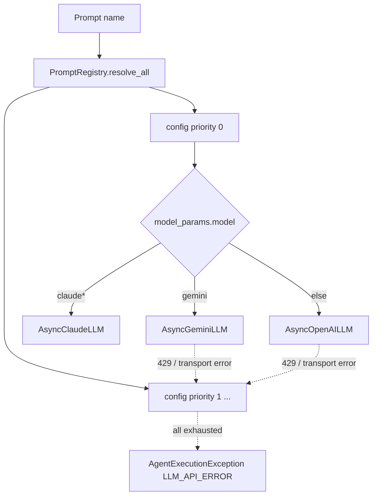

# 06 · LLM Model Choices

## Overview

Patient+ uses **three LLM providers**, each behind its own async client, selected **per-prompt** via
YAML rather than in code. A single `LLMFactory` resolves the ordered provider configs for a prompt
and executes them with **priority-ordered fallback** (fail over on rate-limit / transport errors).
Provider strengths are matched to tasks: **OpenAI GPT-5 family** for reasoning/analytics/formatting,
**Gemini** for orchestration, summarisation, and *grounded web search*, and **Claude Opus 4.6** as an
alternate high-reasoning provider.



## The three providers

Clients in [utils/model_clients/](../utils/model_clients):

| Provider | Client class | File | Transport |
|----------|--------------|------|-----------|
| Azure OpenAI | `AsyncOpenAILLM` | [openai_client.py](../utils/model_clients/openai_client.py) | `openai.AsyncAzureOpenAI`, Azure AD bearer token |
| Gemini (via GSK gateway) | `AsyncGeminiLLM` | [gemini_client.py](../utils/model_clients/gemini_client.py) | raw `aiohttp` POST to `generateContent` |
| Claude (Anthropic on Vertex AI) | `AsyncClaudeLLM` | [claude_client.py](../utils/model_clients/claude_client.py) | subclasses `AsyncGeminiLLM`; Anthropic Messages API |

**Design detail:** `AsyncClaudeLLM` **inherits** `AsyncGeminiLLM` (reusing session management,
retry, token estimation) and overrides only `_build_runtime_config` and `_build_payload` for the
Anthropic Messages format (`anthropic_version`, `messages`, top-level `system`, extended-thinking
`thinking.budget_tokens`).

## The LLM factory — how models are selected

[linked_services/runtime/llm_factory.py](../linked_services/runtime/llm_factory.py), class
`LLMFactory`:

- **Public API:** `async run(prompt_name, user_input, variables)` (non-streaming) and
  `async run_stream(...)` (streaming). **There is no `get_llm` method** despite it being referenced
  in the conventions doc — see Room for Improvements.
- **Routing is prompt-driven, not code-driven.** `run()` calls `registry.resolve_all(prompt_name)` →
  an ordered list of provider configs → `_build_runner(cfg)` picks the client from
  `cfg["model_params"]["model"]`:
  - `model == "gemini"` → Gemini
  - `model.startswith("claude")` → Claude
  - otherwise → OpenAI (`call_openai_chat(model_name=model, …)`)
- **Fallback chain:** configs are sorted by `priority` (lower first). On `RETRYABLE_ERRORS =
  (RateLimitError, aiohttp.ClientError)` the factory falls through to the next config; if all are
  exhausted it raises `AgentExecutionException(ErrorCode.LLM_API_ERROR)`.
- **Streaming support:** OpenAI streams via `call_openai_chat_stream`; Gemini streams via
  `call_gemini_stream` (`:streamGenerateContent`); **Claude has no streaming** — `run_stream` detects
  `model.startswith("claude")` and falls back to a single non-streaming yield.

## Where model names live (prompt YAMLs)

Model selection is expressed per-prompt via `model_params.model`, and the **provider is inferred from
the folder path** (`prompts/**/openai/`, `.../gemini/`, `.../claude/`) in
`PromptRegistry._extract_provider()`.

**OpenAI deployments found** (in `prompts/agents/openai/`, `prompts/tools/openai/`):

- `gpt-5-mini`
- `gpt-5.2`
- `gpt-5.4`
- `gpt-5.4-nano`

**Gemini** (`prompts/agents/gemini/`, `prompts/reflection/`): `model: gemini` (a literal routing
key — the actual Gemini model/version is fixed by the endpoint URL `GENERATE_CONTENT_URL`, not the
YAML). Params include `thinking_budget` (seen: `1`, `128`, `256`) and `use_web_search: True`.

**Claude:** routing uses `model.startswith("claude")`; the specific model is pinned by the endpoint
URL. The default `CLAUDE_API_URL` in [config/constants.py](../config/constants.py) points at
`.../claudeopus46/...` → **Claude Opus 4.6** on Vertex AI, `CLAUDE_ANTHROPIC_VERSION =
vertex-2023-10-16`.

## Default model config keys ([config/constants.py](../config/constants.py))

| Getter | Default | Used for |
|--------|---------|----------|
| `GENERATION_MODEL()` | `gpt-4o` | fallback generation model |
| `DEFAULT_ORCHESTRATOR_MODEL()` | `gemini` | query decomposer, scope classifier |
| `DEFAULT_SUMMARIZER_MODEL()` | `gemini` | conversation summarisation |
| `MODEL_TEMPERATURE()` | `0` | determinism |
| `OUTPUT_TOKEN()` | `4000` | output cap |
| `MAX_TOKENS()` | `45000` | OpenAI context budget |
| `MAX_TOKENS_GEMINI()` | `800000` | Gemini large-context budget |
| `LLM_CONCURRENCY_LIMIT()` | `15` | shared LLM semaphore |
| `OPENAI_VERSION()` | `2025-01-01-preview` | Azure API version |

## Why Gemini for web search

Gemini is chosen for grounded web search because of native Google Search grounding. In
[gemini_client.py](../utils/model_clients/gemini_client.py), when `use_web_search` is true the
payload adds:

```python
payload["tools"] = [{"google_search": {}}]
payload["toolConfig"] = {"functionCallingConfig": {"mode": "ANY"}}
```

The web agent returns text + raw `groundingMetadata`, later parsed into citations. Gemini safety
filters are set to `OFF` for all four HARM categories (`_safety_config`); Claude has no safety config.

## Auth for models

- **OpenAI:** Azure AD bearer token via `get_bearer_token_async()` from
  [linked_services/llm_token/llm_token_manager.py](../linked_services/llm_token/llm_token_manager.py)
  — a singleton `TokenManager` with proactive refresh (`_REFRESH_BUFFER_SECONDS = 300`), OAuth2
  client-credentials, retry+backoff. The client is rebuilt when the token rotates.
- **Gemini / Claude:** same bearer-token mechanism with `Authorization: Bearer` headers to the GSK
  gateway URLs.

---

## Room for Improvements

- **Reconcile the `get_llm` reference.** [.github/copilot-instructions.md](../.github/copilot-instructions.md)
  documents `runtime.llm_factory.get_llm("openai")`, which does not exist. Either add a thin
  `get_llm()` convenience wrapper or fix the docs to describe `run()` / `run_stream()`.
- **Add Claude streaming.** `run_stream` degrades Claude to a single yield; the Anthropic Messages
  API supports SSE streaming and would improve perceived latency when Claude is the active provider.
- **Centralise model routing.** Provider selection is spread across prompt folders. A single
  auditable routing config (prompt → ordered `[model, priority]`) would make "which model runs
  what, and what it falls back to" reviewable at a glance and easier to cost-model.
- **Pin Gemini/Claude model versions explicitly.** Their versions are baked into endpoint URLs, so
  the YAML `model: gemini` is opaque. Recording the resolved model+version (in config and in logs)
  aids reproducibility and eval attribution.
- **Reconsider disabling all Gemini safety filters.** `_safety_config` sets every HARM category to
  `OFF`. For clinical text this may be intentional (medical terms trip safety filters), but it
  should be paired with an explicit output-safety pass (see
  [02 · Loop Engineering](02-loop-engineering.md)) so nothing unsafe reaches users unchecked.
- **Expose per-provider token/cost accounting.** Combined with observability improvements, capturing
  prompt/completion tokens per provider enables cost dashboards and informed model-downgrade
  decisions (e.g. move a formatting task from `gpt-5.4` to `gpt-5.4-nano`).

## Quiz

**Q1. Why use three providers instead of standardising on one?**
Each has a distinct edge: OpenAI GPT-5 for strong structured reasoning/analytics, Gemini for native
Google-Search grounding and huge context (800K tokens) for summarisation, and Claude Opus 4.6 for
extended-thinking reasoning as a fallback. Multi-provider also gives **resilience** — a 429 on one
fails over to another. *Alternative:* single provider. *Could differ:* one provider simplifies ops
and billing but loses grounding/context/redundancy advantages.

**Q2. Why is Gemini the default orchestrator and summariser?**
Orchestration (decomposition, scope classification) and summarisation are high-context, latency- and
cost-sensitive tasks where Gemini's 800K context and pricing shine, and grounding isn't needed there.
*Alternative:* GPT-5 for orchestration. *Could differ:* GPT-5 might classify more precisely at higher
cost — a candidate for an eval-driven A/B.

**Q3. Why route models by prompt-folder path rather than in code?**
It makes model choice a **content decision**, not a code change — swapping a task's model is a
YAML/folder edit, decoupled from deploys of logic. `PromptRegistry._extract_provider()` reads the
folder. *Alternative:* a code-side routing table. *Could differ:* a single central routing file would
be easier to audit than folder convention (see Room for Improvements).

**Q4. Why does `AsyncClaudeLLM` inherit from `AsyncGeminiLLM`?**
Both call HTTP gateways with bearer auth, share session pooling, retry, and token-estimation logic;
only the request/response shape differs (Anthropic Messages vs Gemini `generateContent`).
Inheritance reuses ~80% of the client. *Alternative:* a shared base class both extend. *Could
differ:* a common `BaseHttpLLM` base would be cleaner than Claude depending on Gemini's identity, but
functionally equivalent.

**Q5. Why priority-ordered fallback on rate-limit/transport errors specifically?**
Those errors (`RateLimitError`, `aiohttp.ClientError`) are transient and provider-specific —
retrying the *same* provider often fails again, but a *different* provider usually succeeds. Content
errors (bad prompt) aren't retried, since they'd fail everywhere. *Alternative:* retry same provider
with backoff. *Could differ:* combine — backoff-retry same provider a few times, *then* fail over.

**Q6. Why set Gemini temperature to 0 and safety to OFF?**
Temperature 0 maximises determinism/reproducibility for analytics and classification; safety OFF
prevents clinical vocabulary (diseases, drugs, procedures) from being wrongly blocked as harmful
content. *Alternative:* low-but-nonzero temperature, default safety. *Could differ:* keep safety on
with a medical allowlist, or add a separate output-safety classifier so OFF isn't a blanket bypass.
