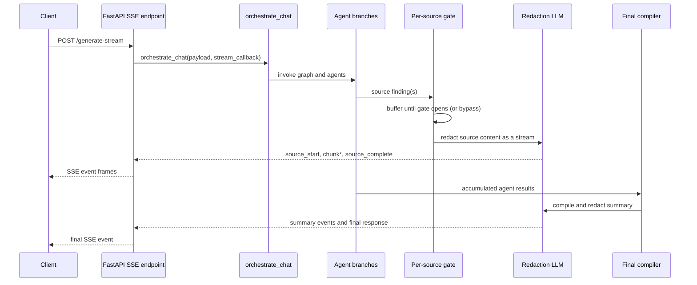

# Streaming Responses in Patient Plus

## 1. Theoretical Foundations

### Problem and model

The ordinary request/response model returns one complete result after retrieval, agent execution, compilation, and redaction have all finished. Streaming changes the delivery contract: the backend sends a sequence of events while the request is still running, so the client can render progress and completed source sections before the canonical final response exists.

This is an **incremental delivery** problem, not model training. There is no loss function, gradient update, embedding tensor, or train/inference shape transformation in this feature. The core state is text and event metadata:

```text
agent finding:       {source_name, content, agent_type, query?}
redaction stream:    AsyncIterator[str]
SSE event:           {type, source_name, heading, content, data, sequence, is_final}
wire frame:          data: <JSON event>\n\n
```

The source gate groups findings by source. For a normal source, the gate opens after `expected_count` findings arrive; single-result sources such as web search and configured Glean/market-research sources bypass that count. If a source has $n$ expected sub-query findings, its first deliverable result cannot be produced until the slowest required finding is available:

$$
T_{source-ready} \approx \max_{i=1,\ldots,n} T_i
$$

For one source, time to first visible content is approximately:

$$
T_{first-content} = T_{source-ready} + T_{optional-synthesis} + T_{redaction-first-token} + T_{transport}
$$

This can improve perceived latency without reducing total compute. If source emission is serialized, total stream completion is closer to the sum of each source's redaction/emission time than the maximum of those times.

### Architectural flow



In the current code, early source streaming is driven by `source_ready_callback` injected by `orchestrator_entry.orchestrate_chat()`. Agent/tool paths call it as findings form. It buffers findings in `shared_source_buffer`, synthesizes a source only when multiple findings need combining, and routes the result through `stream_source_result_through_compiler()`. After the graph finishes, `compiler_node` compiles the accumulated results and emits summary/final events.

This differs from the older design narrative in [STREAMING_FLAG_APPROACH_IMPLEMENTATION.md](../docs/STREAMING_FLAG_APPROACH_IMPLEMENTATION.md) and [STREAMING_HLD.md](../docs/STREAMING_HLD.md): those docs describe the compiler node itself looping over sources after fan-in. The live path performs early per-source work through the callback; `compiler_node` is the final compilation/summary phase. The `generate_summary` state flag still controls compiler behavior, but it is not the trigger for early source delivery.

### Trade-offs and alternatives

| Pattern | Strength | Limitation |
|---|---|---|
| Buffered JSON response | Simple contract, easy to retry and reconcile | Client sees nothing until the slowest stage finishes |
| SSE | Natural one-way server-to-client events over HTTP; reconnect/proxy support is widely available | No client-to-server messages on the same channel; event ordering and disconnect cleanup remain application responsibilities |
| WebSocket | Bidirectional control, useful for live cancellation or collaboration | More connection lifecycle and infrastructure complexity than this one-way response needs |
| Independent source requests | Sources can be fetched/rendered independently | More client orchestration, duplicated request context, and harder canonical final reconciliation |

The implemented choice is SSE because response streaming is one-way. Streaming is not automatically faster: it mainly improves time-to-first-content, and it adds buffering, ordering, partial-failure, retry, and privacy concerns.

## 2. Practical and Engineering Implementation

### Code walkthrough

**Transport.** `fastapi_v1.process_endpoint_stream()` exposes `POST /api/patient-plus/genai-backend/generate-stream`. It creates an `asyncio.Queue`, supplies a callback that normalizes events and enqueues them, then serializes queue items as `data: <JSON>\n\n`. The response disables proxy buffering with `X-Accel-Buffering: no` and uses `text/event-stream`.

**Orchestration and gating.** `orchestrator_entry.orchestrate_chat()` injects `source_ready_callback` into graph state and keeps shared sequence, gate, buffer, and streamed-source state. `source_ready_callback()` counts findings by source; a once-only set prevents duplicate output. It filters no-data placeholders, passes one result directly, and calls `CompilerAgentV2.compile_source_only(..., skip_redaction=True)` when multiple findings need synthesis.

**Redaction and formatting.** `stream_source_result_through_compiler()` starts a source lifecycle, consumes `redact_persons_stream(content)`, pushes model chunks through `IncrementalMarkdownStreamFormatter`, emits formatter deltas as `chunk` events, flushes the formatter, and emits `source_complete`. Redacted content is also retained in `streaming_sections` for final response assembly and persistence.

**Provider behavior.** `LLMFactory.run_stream()` streams OpenAI and Gemini model output. Claude currently falls back to a buffered `run()` call and yields the completed text as one chunk. Thus the event contract is progressive across providers, but the actual token-level UX depends on the configured provider.

**Final response.** `orchestrator_workflow.compiler_node()` sets `generate_summary=True`, compiles deduplicated agent results, then emits summary events and the canonical `final` event. Non-streaming requests retain the regular final-response path.

### Source excerpts

The source gate and once-only guard are implemented in `orchestrator_entry.source_ready_callback()`:

```python
effective_expected = 1 if source_bypasses_gate else expected_count

if current_count < effective_expected:
	await logger.info(
		parent_id=parent_id,
		child_id=conversation_id,
		module="orchestrator_entry",
		message=(
			f"📥 Buffered finding {current_count}/{effective_expected} "
			f"for source '{source_name}'"
		),
	)
	return  # gate stays closed — wait for more findings

# Gate opens — mark as streamed and take ownership of findings.
shared_streamed_sources.add(source_name)
findings = list(shared_source_buffer[source_name])
```

The redaction stream and formatter boundary are in `compiler_agent.stream_source_result_through_compiler()`:

```python
async for token in redact_persons_stream(content):
	markdown_delta = formatter.push(token)
	if markdown_delta:
		await stream_callback({
			"type": "chunk",
			"source_name": event_source_name,
			"heading": heading,
			"content": markdown_delta,
			"data": None,
			"is_final": False,
			"sequence": seq,
		})
		seq += 1
```

Provider fallback behavior is in `llm_factory.LLMFactory.run_stream()`:

```python
if model_name.startswith("claude"):
	 runner = self._build_runner(cfg)
	 text = await runner(user_input)
	 if text:
		 yield text
	 return

# Gemini: true streaming via :streamGenerateContent
```

These excerpts are verbatim from the current implementation; the design docs describe intended behavior and are not substitutes for checking the runtime code.

### Data pipeline and operational dimensions

There are no tensor dimensions here. Relevant cardinalities and transformations are:

| Stage | Shape / representation |
|---|---|
| Query analysis | `sub_queries: List[DecomposedQuery]` |
| Agent output | Multiple findings, grouped as `source_name -> List[source_event]` |
| Source synthesis | One source's findings become one text body (only when needed) |
| Redaction | Text input becomes `AsyncIterator[str]` provider chunks |
| Markdown formatting | Provider token chunks become zero or more safe-to-render markdown deltas |
| Transport | One JSON SSE event per progress update or content delta |
| Final response | Complete compiled response plus retained source sections |

### Performance, scale, and bottlenecks

- Agent branches may run concurrently, but normal per-source gates wait for all expected findings for that source. A large `sub_queries` count can delay early output even when some findings are already available.
- Multiple findings for a source incur an additional synthesis LLM call before redaction. A single finding skips that synthesis call.
- Each streamed source and summary incurs a redaction-model call. The redaction call, first-token latency, provider throttling, and output length are material costs.
- `shared_sequence_state["lock"]` is held while source content is streamed through the compiler helper. This preserves sequence order but serializes source token emission and can make a slow source delay another ready source.
- The SSE queue is created as an unbounded `asyncio.Queue()`. A slow client can allow queued events to accumulate; there is no explicit bounded-queue backpressure in this endpoint.
- Source findings and `streaming_sections` retain response text for later compilation/reconciliation. Memory usage therefore grows with result size and concurrent requests.
- `LLMFactory.run_stream()` may move to a fallback provider after a retryable streaming error. If output was already yielded, restarting on another provider can duplicate or alter the prefix unless the caller detects that partial output occurred.
- SSE progress heartbeats are emitted while waiting for work, which keeps intermediaries active but does not make model processing faster.

For a simple queueing model, if events arrive at rate $\lambda$ and a client consumes them at rate $\mu$, backlog grows whenever $\lambda \geq \mu$. Little's law, $L = \lambda W$, relates average queued events $L$, arrival rate $\lambda$, and time in the system $W$; bounded queues or disconnect cancellation are needed to limit resource use under slow consumers.

### Production deployment and observability

Track at least:

- Request latency, time to first progress, time to first real source chunk, and time to final event.
- Per-source gate wait, finding count versus expected count, synthesis duration, redaction time-to-first-token, and redaction completion time.
- Model/provider, retry/fallback count, tokens/chars emitted, empty output, and failures after partial output.
- SSE queue depth, event rate, client disconnects, cancelled tasks, heartbeat count, and concurrent streams.
- Duplicate source/final events, non-monotonic sequence numbers, and discrepancies between streamed content and the final canonical response.
- Privacy incidents or redaction validation failures; avoid logging raw patient content or identifiers in telemetry.

The redaction prompt's intent is not a security boundary. `redact_persons_stream()` forwards model output as it is generated; it does not validate each chunk against an independent deterministic PII detector before emission. A model can emit an identifier, revise its intended wording later, or fail to redact. For high-sensitivity data, consider buffering until output validation passes, or use deterministic detection/tokenization before the model and an independent post-generation check. Once a chunk is sent, it cannot be recalled.

## 3. Technical Interview Preparation

### System design scenarios

**1. Scale the streaming endpoint to 10,000 concurrent clients.**

- Separate stateless request handling from agent/model execution; use worker pools and explicit per-request deadlines.
- Bound per-connection queues and define a slow-consumer policy (throttle, coalesce, or cancel); do not allow unbounded buffering.
- Apply model-provider concurrency limits, rate limiting, and admission control before expensive work begins.
- Keep event payloads small; send deltas rather than repeatedly sending full accumulated text.
- Ensure events have request IDs and monotonic sequence numbers; make final reconciliation idempotent.
- Measure active streams, queue depth, provider saturation, first-token latency, and cancellation effectiveness.
- Validate load balancer/proxy idle timeouts, HTTP/2 behavior, and SSE buffering in the deployment path.

**2. Design a privacy-safe, multi-source streaming answer when sources have different completion times.**

- Define whether a source is complete after one result or after all sub-query results; make the gate contract explicit and observable.
- Emit independent source lifecycle events and let fast sources render without waiting for unrelated slow sources.
- Preserve one canonical final payload and reconcile it against streamed sections.
- Treat model-based redaction as probabilistic; use deterministic PII controls or validated buffering before exposing sensitive output.
- Define source-level timeout/error events and whether partial responses remain useful when one source fails.
- Decide retry semantics before first output versus after first output; avoid replaying already delivered chunks.
- Keep audit logs metadata-only and apply retention controls to buffered content.

### Deep-dive questions and strong answers

**Why use SSE instead of polling or WebSockets?** SSE matches a one-way server-to-client result stream and keeps HTTP request semantics. Polling adds repeated requests and latency; WebSockets are appropriate if the client must send live control messages, but add bidirectional connection management. SSE still needs explicit ordering, heartbeat, reconnection, and cancellation design.

**What does the source gate buy, and what can go wrong?** It avoids emitting a partial synthesis when multiple sub-query findings contribute to one source. It trades earlier partial visibility for coherent source-level output. If `expected_count` is wrong or an agent never calls back, the gate can remain closed; if it is too low, later findings can be omitted. Bypass sources and once-only guards address known one-result and duplicate cases, but gate completion should be monitored and time-bounded.

**Does streaming from the redaction LLM guarantee PII safety?** No. It places redaction before the transport, which is safer than streaming raw refinement output, but a generative redactor is not a formal filter. Partial output is irreversible. Strict controls require a deterministic pre-filter or a validation/buffering stage that can reject content before it is sent.

### Common gotchas and troubleshooting

- **Sensitive text leaks in a streamed prefix.** A redaction model may emit an identifier despite its instructions. Treat every emitted chunk as externally disclosed; inspect redaction behavior with adversarial PII tests and add independent validation before release.
- **Duplicate or inconsistent text after a mid-stream retry.** A fallback model can restart the answer after some chunks have already been sent. Record whether any bytes were emitted and do not transparently restart; terminate with a source error or use an explicit reset/revision protocol.
- **A source never appears.** Compare actual finding callbacks with `source_gate_config["expected_count"]`; check source-specific bypass configuration, no-data filtering, callback exceptions, and timeout handling.
- **Slow sources block ready sources or consume memory.** Inspect sequence-lock hold time, SSE queue depth, client consumption rate, and retained `streaming_sections`; bound queues and establish cancellation/slow-client behavior.
- **Client view differs from final response.** Check formatter flush behavior, source canonicalization, citation transformations, summary insertion, and whether the final event is emitted exactly once. Use the final response as the canonical reconciliation payload.
