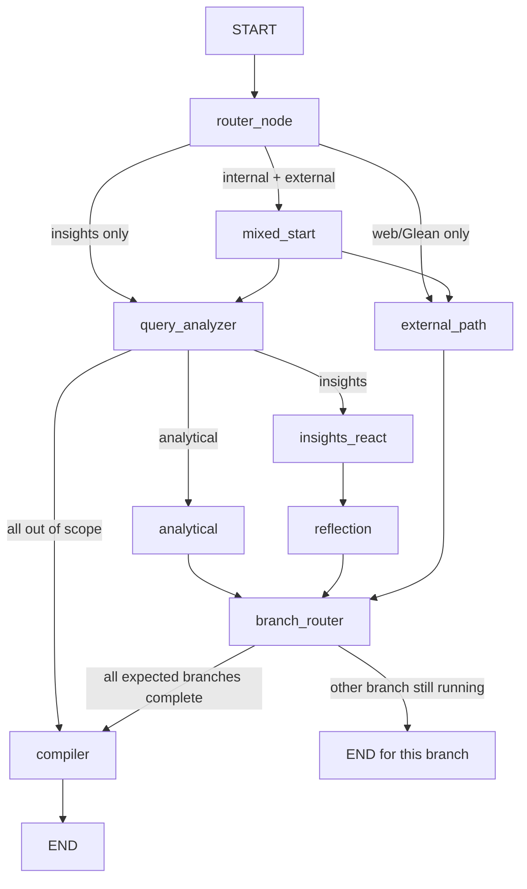

# LangGraph End-to-End in Patient Plus

## 1. Theoretical Foundations

### What LangGraph contributes

LangGraph models an application workflow as a directed graph of state-transforming nodes. A node reads the current state and returns a partial state update; edges determine which node or nodes execute next. Conditional edges let runtime state choose the next route, while reducers define how concurrent updates to the same state channel are combined.

This repository uses LangGraph for **LLM application orchestration**, not model training. The graph does not optimize a loss or manipulate embedding tensors. Its principal data is a typed request, decomposed queries, agent results, routing metadata, and compiled text.

At a high level, for state $S_t$, a node returns a patch $\Delta S_t$. For parallel nodes $N_1,\dots,N_m$, each returns a patch, and state channels are updated by their configured reducer:

$$
S_{t+1}[k] = R_k\left(S_t[k], \Delta S_1[k], \ldots, \Delta S_m[k]\right)
$$

For append-only list channels using `operator.add`, $R_k$ concatenates updates. For channels without a reducer, a parallel write to the same key is not an implicit merge strategy and may produce an update conflict. This makes state schema design part of graph correctness.

### Why use a graph instead of a linear chain?

Patient analytics requests can take different paths: internal retrieval/analysis, external search, or both. A graph expresses that branching and parallel work directly. It also centralizes fan-in behavior: agent branches report completion, then a compiler creates one response.

The graph provides orchestration structure; it does not automatically provide durable workflow state, exactly-once side effects, API retries, cancellation semantics, or validation of a `TypedDict`. Those remain application responsibilities.

### Current graph at a glance



The `insights_react` node contains an additional LLM-driven Plan/Execute/Observe loop (up to `MAX_REACT_STEPS = 3`), but that loop is implemented inside the agent, not as a cycle in the outer LangGraph. `external_path` also runs web and configured Glean work with `asyncio.gather` inside one node.

For mixed requests, the internal and external branches run in parallel. If their durations are $T_i$ and $T_e$, the fan-in wait is approximately:

$$
T_{fan-in} \approx \max(T_i, T_e)
$$

The final response still waits for the compiler and any work it performs:

$$
T_{request} \approx T_{memory-load} + T_{fan-in} + T_{compiler} + T_{memory-save}
$$

This is a conceptual latency model; tool and model calls may themselves contain parallelism, retries, and variable provider latency.

### Alternatives and trade-offs

| Pattern | Strength | Limitation |
|---|---|---|
| Linear async function chain | Simple for fixed workflows and easy to debug | Conditional paths and parallel joins become nested conditionals and manual coordination |
| LangGraph `StateGraph` (current) | Explicit state transitions, conditional routing, and parallel fan-out/fan-in | Requires careful reducer design and graph-level tests; graph structure can obscure side effects hidden in node helpers |
| Message broker/workflow engine | Durable queues, independent worker scaling, and potentially resumable work | Adds infrastructure, idempotency, serialization, and operational complexity |

LangGraph is a good fit for a request-scoped orchestration graph. If requests must survive process restarts or resume after human approval, the current plain compiled graph needs a persistence/checkpoint design rather than relying on the graph alone.

## 2. Practical and Engineering Implementation

### End-to-end request lifecycle

1. **Entry and request state.** `orchestrator_entry.orchestrate_chat()` resolves the runtime and creates a `ChatRequest` plus the initial `GraphState`. Streaming requests inject callbacks and shared event-ordering state; ordinary requests leave the streaming callback unset.
2. **Conversation context load.** `async_memory_loader_node()` runs before the graph. It ensures the parent/session record, saves the user query as processing, and loads prior source summaries and conversation rows into `source_memory`/`context_list`.
3. **Graph invocation.** `_COMPILED_GRAPH` is built once at module import. Each request calls `graph.ainvoke(initial_state)`, producing a final state when the graph completes.
4. **Top-level route.** `router_node()` reads request flags and data sources. It returns `expected_branches`, `expected_sources`, and execution metadata; `router()` selects `query_analyzer`, `external_path`, or `mixed_start`.
5. **Query analysis.** `query_analyzer_node()` calls `analyze_query()` to classify the request, decompose it, and assign scope/tool hints. It returns `query_type`, `sub_queries`, and any out-of-scope `AgentResult`s. If analysis fails, it creates a single-query insights fallback.
6. **Internal work.** `type_router()` routes analytical requests directly to `analytical_node`, qualitative requests to `insights_react_node`, and all-out-of-scope requests directly to `compiler`. The ReAct agent invokes tools and tracks observations/source answers in a per-run scratchpad. Insights results then pass through `reflection_node`, which evaluates answers and can replace weak answers with regenerated results.
7. **External work.** `external_path_node()` runs web and/or Glean calls concurrently inside the node and normalizes their results. In mixed mode, this node runs in parallel with the internal path.
8. **Join and compile.** Agent nodes append their completed branch names and results. `branch_router()` checks whether all expected branch names are present; once they are, it routes to `compiler_node`. The compiler deduplicates results, synthesizes/structures the response, formats it, and creates the canonical final response.
9. **Return and persistence.** The entry layer converts the final response to the API shape. In its `finally` block, it calls `async_memory_saver_node()` when a final state is available; this updates source memory, conversation output, and Glean context IDs. Saver failures are logged after response processing and do not replace a response already produced.

### State contract and reducer semantics

`apps/state/state.py` defines `GraphState` as a `TypedDict`, with nested `DecomposedQuery`, `AgentResult`, and `ErrorInfo` contracts. `TypedDict` helps static analysis, but does not perform runtime validation. The central accumulated channels include:

```python
agent_results: Annotated[List[AgentResult], operator.add]
execution_path: Annotated[List[str], operator.add]
expected_branches: List[str]
completed_branches: Annotated[List[str], operator.add]
```

The reducer on `agent_results` allows parallel agents to contribute result lists without one patch overwriting another. `completed_branches` and `execution_path` use the same append-merge pattern. `branch_router()` converts the expected and completed lists to sets before checking subset completion, so duplicate branch entries do not affect the gate.

The declarations above are separate verbatim excerpts from `apps/state/state.py`; unrelated fields between them are omitted.

Other fields are ordinary state channels: query classification, `sub_queries`, `source_memory`, `compiled_response`, `final_response`, and error metadata. The graph also receives runtime services and streaming callbacks in state. Several streaming coordination objects are shared mutable dictionaries guarded with `asyncio.Lock`; those side effects are not made durable or race-free merely by storing them in `GraphState`.

### Routing and merge code excerpts

The request-level route selection is in `orchestrator_workflow.router()`:

```python
def router(state: GraphState) -> str:
	"""Conditional edge after router_node — 3 routes only."""
	expected_set = set(state.get("expected_branches", []))
	if expected_set == {"insights"}:
		return "insights_path"
	if expected_set == {"external"}:
		return "external_path"
	return "mixed_path"
```

Query type selection is in `type_router()`:

```python
if not state.get("sub_queries"):
	return "compiler"

if query_type == "analytical":
	return "analytical"

# "insights", "web", "out_of_scope" — anything else goes through ReAct
return "insights"
```

Branch convergence is in `branch_router()`:

```python
expected = set(state.get("expected_branches", []))
completed = set(state.get("completed_branches", []))

if expected.issubset(completed):
	return "compiler"

return END
```

The parallel start edges are in `build_orchestrator_graph()`:

```python
graph.add_edge("mixed_start", "query_analyzer")
graph.add_edge("mixed_start", "external_path")
```

The query type conditional mapping in that same function is:

```python
graph.add_conditional_edges(
	"query_analyzer",
	type_router,
	{
		"analytical": "analytical",
		"insights": "insights_react",
		"compiler": "compiler",
	},
)
```

The terminal compiler edge and graph compilation are:

```python
graph.add_edge("compiler", END)

return graph.compile()
```

These code excerpts are verbatim from the current implementation. The exact route mapping registered for `router_node` is also in `build_orchestrator_graph()`; the helper's string return values are mapped to graph node names there.

### Streaming is application-managed, not LangGraph-native

The request layer does not call `graph.stream()`, `graph.astream()`, or `astream_events()`. It invokes the graph with `ainvoke()` and emits SSE through `stream_callback` calls made by nodes/agents and the orchestrator. Early source output is driven by `source_ready_callback`; the compiler later emits the summary/final response. This gives the application control over event shape and source gating, but it means event ordering, cancellation, and reconciliation are outside LangGraph's graph-state reducer mechanism.

In particular, the insights agent receives `source_ready_callback` while executing, and the outer graph runs `reflection_node` after `insights_react_node`. That means an insights result can be sent to the client before reflection evaluates or regenerates it. The final compiler response can therefore differ from already streamed source text. If the quality gate is intended to govern user-visible output, defer that source callback until after reflection or provide a correction/revision protocol.

### Error and recovery behavior

- `@handle_async_node_exception` wraps selected graph nodes. An `AgentException` is logged, copied into `state["error"]`, marks `is_error_state=True`, and is re-raised as an `AgentExecutionException` with a safe state snapshot. Timeouts receive a timeout-specific state/error code.
- `query_analyzer_node()` has a local fallback: on analysis failure it routes one fallback query through the insights path rather than failing the graph immediately.
- `external_path_node()` gathers independent web/Glean work with `return_exceptions=True`. A Glean node-level crash can be converted into source-labelled error results, allowing compilation to explain partial failure.
- The outer `orchestrate_chat()` catches agent and unexpected exceptions and builds API error results. The `finally` block attempts memory saving only if a final state exists.
- There is no graph-level `RetryPolicy` registered in the builder. Retries exist in lower-level model/API clients and must be distinguished from node retries.

### Persistence boundary: SQL memory is not a LangGraph checkpoint

`async_memory_loader_node()` and `async_memory_saver_node()` are called by the entry layer around `graph.ainvoke()`. They manage conversation summaries, source histories, query/response rows, and Glean chat IDs in SQL. The graph is compiled without a `checkpointer`; the invocation has no `thread_id` config for LangGraph checkpoint state. Consequently:

- Conversation context can persist between user turns through application-managed SQL memory.
- Intermediate graph state is not checkpointed for crash recovery or resume.
- A process failure during a graph run loses its in-flight state and does not resume from the last node.
- SQL memory writes are side effects and need their own idempotency/transaction behavior; they are not covered by a graph checkpoint.

The relevant invocation is in `orchestrator_entry.orchestrate_chat()`:

```python
graph = _COMPILED_GRAPH

final_state = await graph.ainvoke(initial_state)
```

### Data shape through the workflow

There are no model tensor dimensions at the LangGraph level. The conceptual state progression is:

| Boundary | Important values |
|---|---|
| Entry | `ChatRequest`, runtime, empty result lists, response defaults, optional stream callbacks |
| Router | `expected_branches`, `expected_sources`, route decision |
| Analyzer | `query_type`, `is_complex_query`, `sub_queries: List[DecomposedQuery]`, out-of-scope results |
| Agents | `agent_results: List[AgentResult]`, source IDs, tool metadata, status/errors |
| Join | accumulated `completed_branches`; one or both logical branches complete |
| Compiler | deduplicated results, `compiled_response`, `source_insights_map`, `final_response` |
| Post-graph saver | SQL conversation record, source memories, persisted context IDs |

### Performance, scale, and telemetry

- The graph itself is lightweight; latency is dominated by query analysis, retrieval/analytics tools, ReAct planning/tool calls, reflection evaluation/regeneration, external API latency, compiler LLM calls, and SQL operations.
- Mixed requests reduce branch wall-clock time through concurrency, but the final compiler waits for both expected branches. Tail latency is controlled by the slowest branch.
- `external_path_node()` and some tool paths use `asyncio.gather`; no graph-level global concurrency budget is visible in `build_orchestrator_graph()`. Per-request fan-out and model/provider limits should be considered under concurrent load.
- Reflection can add another evaluation and possible regeneration stage to insights requests. This improves quality gating at the cost of latency and tokens.
- State accumulates all `AgentResult` text and source metadata until compilation. Large result sets or many concurrent requests increase memory use.
- Mutable callback/buffer objects stored in state are request-scoped but shared among concurrent branches. Locks and ownership boundaries must remain explicit.

Monitor route frequency, node start/end duration, branch fan-out and wait time, expected/completed branch counts, sub-query count, tool/model calls per request, reflection pass/regeneration rates, compiler latency, token usage, exception/timeout codes, SQL load/save latency, and streamed-versus-final content mismatch. Avoid recording raw patient content in telemetry.

## 3. Technical Interview Preparation

### System design scenarios

**1. Add durable resume and human approval to this request graph.**

- Choose a LangGraph checkpointer and define a stable `thread_id`/checkpoint namespace based on tenant and conversation identity.
- Separate durable graph state from runtime-only services, callbacks, locks, and non-serializable objects; inject those through runtime/config rather than checkpointing them.
- Add explicit interrupt points before approval-sensitive side effects and define resume semantics.
- Make external calls and SQL writes idempotent because a resumed node may be re-executed.
- Set checkpoint retention, encryption, access controls, and PHI-aware deletion policies.
- Test process termination at every node boundary, resume, duplicate tool execution, and stale checkpoint/schema upgrades.

**2. Scale mixed internal/external requests while preserving partial failure behavior.**

- Retain explicit route and branch contracts, but impose per-request and global concurrency limits on retrieval, Glean, and model calls.
- Add per-branch deadlines and cancellation propagation; return typed per-source errors when partial success is acceptable.
- Preserve reducer-backed list accumulation and make non-reducer writes disjoint across parallel branches.
- Use timeouts and circuit breakers around slow dependencies; avoid retry amplification.
- Record branch start/finish times and fan-in wait so tail latency is attributable.
- Load test mixtures of fast/slow/failing branches, large sub-query counts, and high concurrent request volume.

### Deep-dive questions and strong answers

**What does `Annotated[List[T], operator.add]` mean in `GraphState`?** It assigns a reducer to that state channel. When multiple graph nodes return list updates, LangGraph combines them by list addition instead of treating the channel as a single-write value. It is suitable for independent result/completion contributions, but repeated execution can append duplicates, so the application still needs deduplication or idempotency.

**How does `branch_router()` implement a fan-in barrier?** Each branch returns its completion marker into the reducer-backed `completed_branches` channel. The router compares sets so duplicates do not change membership and selects `compiler` only when `expected_branches` is a subset of completed branches. Otherwise it returns `END` for that branch while the other active branch can continue. Tests should cover both completion orders and same-step completion.

**Is conversation history checkpointed by LangGraph here?** No. SQL memory is loaded before `ainvoke()` and saved after it; the graph builder calls `compile()` without a checkpointer, and invocation has no checkpoint/thread config. SQL memory stores conversation-level context, not intermediate node state, so it cannot resume an interrupted graph execution.

### Common gotchas and troubleshooting

- **Parallel update conflict.** Two concurrent nodes write different values to the same non-reducer state key. Inspect node return patches and add a reducer only when the merge semantics are well-defined; otherwise make writes disjoint.
- **Expected branch never completes.** A node fails before returning its completion marker, or routing produces an unexpected branch name. Log expected/completed sets and graph execution path; test every request-flag combination.
- **Duplicate agent results.** Retries, ReAct re-execution, or multiple graph paths can contribute repeated records. Verify stable result keys and compiler deduplication behavior.
- **Streaming shows pre-reflection content.** The insights agent calls the source callback during its execution, but reflection runs afterward. Move emission after the quality gate if clients must only see evaluated content, or make final reconciliation handle revisions explicitly.
- **Assuming SQL memory enables resume.** It only restores conversation/source context. For in-flight recovery, add and test a LangGraph checkpointer and keep runtime-only callback/lock objects out of persisted state.
- **Graph behavior changes with mutable state.** Shared dictionaries and callbacks can be mutated outside reducer updates. Scope them per request, guard concurrent mutation, and prefer explicit state patches for durable/observable workflow facts.

### Verification status

The graph topology, reducers, entry invocation, exception wrapper, and memory hooks were checked against the current workspace. A filename search did not find dedicated LangGraph workflow tests; request-route combinations, branch completion orders, reducer accumulation, out-of-scope routing, exception snapshots, and parallel failures are the highest-value cases to cover.
